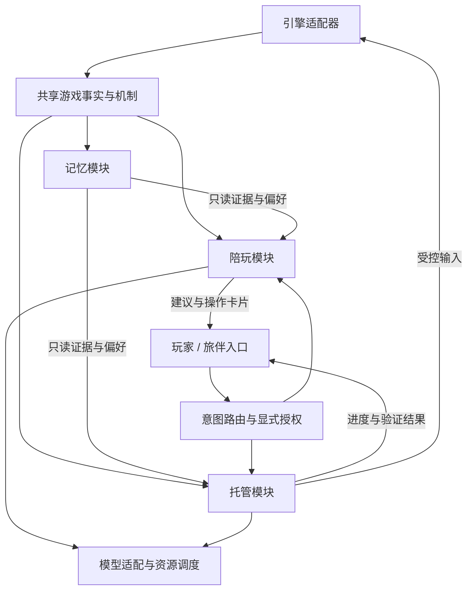

# 旅伴整体需求与交付基线

> 状态：功能已落地，作用域 format / lint / typecheck 已通过；T9 实机验收未做，代码落盘不等于验收通过；2026-10-24。
> 技术与任务依赖：[`technical/companion.md`](./technical/companion.md)
> 记忆专项：[`companion-memory.md`](./companion-memory.md) / [`technical/companion-memory.md`](./technical/companion-memory.md)
> 托管专项：[`game-assistance.md`](./game-assistance.md) / [`technical/game-assistance.md`](./technical/game-assistance.md)
> 有效范围：旅伴入口、记忆 / 陪玩 / 托管的协作、并发与生命周期。此范围内替代旧文档的「自动陪聊走工具循环」「所有能力共占一个活动任务」「模型增强只作远期扩展」约定；其它入口、编辑能力和托管算法沿用各专项。
> [`companion-optimization.md`](./companion-optimization.md) 仅保留历史线索，不能据此另起一套目标。

## 1. 最终效果与交付范围

一次完整交付包含：及时的本地反应、自然的角色表达、主动聊天、跨读档的游玩记忆、有证据的建议、明确授权后的游戏操作，以及操作期间仍能陪聊。允许按任务分批合入，不能把其中任一核心能力永久留在「以后再补」。

验收主线为「被某技能击倒 → 读档 → 再次遇敌 → 引用经历并给出适用建议 → 玩家授权操作 → 托管执行并验证 → 后续成功更新记忆」。陪玩不能仅靠增加固定句式宣称完成；记忆不能仅记录战败计数；托管不能仅打开菜单就宣称目标完成。

本次确定的适配基线为 MV / MZ 标准战斗，以及原生、Chaya 快速 / 自动存档。App / local 与 Cloud 使用相同领域契约，各自通过现有宿主承载；能力按引擎、版本和运行环境声明。RGSS、自定义战斗和无法识别的脚本机制只能展示实际支持项，不假装完整支持，也不另建业务流程。

不包含语音、视频回放、跨设备同步、通用游戏攻略库、向量检索和独立进程服务。这些不是完成上述文字陪玩闭环的前置条件。

## 2. 三个模块、共享接口、一个入口

| 部分           | 职责                                          | 权限与边界                                                 |
| -------------- | --------------------------------------------- | ---------------------------------------------------------- |
| 记忆模块       | 筛选经历、保存证据、统计、检索、偏好与清理    | 唯一长期记忆写入方；基础采集与查询无需模型，不操作游戏     |
| 陪玩模块       | 快速反应、发言调度、角色表达、聊天与建议      | 只读游戏事实和记忆；可提出操作卡片，不能直接调用托管       |
| 托管模块       | 管理目标，观察、决策、操作、验证、暂停与停止  | 唯一持有游戏操作权限的业务模块；按目标和既有工具白名单执行 |
| 游戏事实接口   | 当前状态、领域事件、技能 / 状态机制、适配能力 | 由引擎适配器生产；当前事实不是历史记忆，不各自重复采集     |
| 模型适配与调度 | 不同供应商的生成、流式、预算、超时、取消      | 是共用基础设施，不拥有游戏工具权限或业务记忆               |
| 旅伴入口       | 发送、路由、授权卡片、消息与任务状态展示      | 不承担采集、长期记忆或托管循环；侧栏等入口复用同一实例     |

模块内按职责拆文件，不再增加同级业务模块，不要求单文件实现；具体目录遵守仓库结构约定。三个模块通过契约协作，不依赖对方私有实现。

## 3. 已确定的产品决策

| 决策        | 最终规则                                                                                         |
| ----------- | ------------------------------------------------------------------------------------------------ |
| 反应速度    | 危急提示走本地路径，不等待模型、语义分类或写盘                                                   |
| 自然表达    | 本地优质变体 + 与证据绑定的预生成候选 + 主动聊天的一次短生成；有可用配置时启用增强，提供关闭开关 |
| 对话理解    | 接收真实用户文本、有限近期对话、当前事实和少量相关记忆；不能用无关模板冒充理解                   |
| 托管中聊天  | 允许独立只读陪聊；操作保持独占，模型资源另行限流，不保证同一硬件物理并行                         |
| 记忆来源    | 关键游戏事件与显式用户偏好；不依赖模型整理所有日志，不默认逐帧记录                               |
| 策略准确性  | 区分已观察事实、尝试结果与策略假设；无机制证据时不保证缴械 / 护盾有效                            |
| 模型数量    | 陪玩和托管可复用同一配置，也可分别选择；不强制安装小模型、embedding 模型或第二个大模型           |
| 服务数量    | 使用现有游戏宿主、应用服务和存储；不新增消息队列、向量数据库或专用记忆服务                       |
| 暂停 / 停止 | 关闭面板不停止托管或记忆；停止托管、停止回复、关闭记录分别生效                                   |
| 分阶段实施  | 只改变交付顺序，不改变本页的最终能力与权限边界                                                   |

## 4. 完整用户流程

以下流程编号也是实施任务和验收的追踪键；正常和异常路径都必须覆盖。

### F01 启动、恢复与能力建立

游戏连接 → 宿主创建一次事实、记忆、陪玩与托管实例 → 读取已提交记忆和设置 → 确认游戏 / 版本 / 周目 / 当前实例身份 → 发布能力表 → 以当前快照建立基线 → 订阅事件。先前等级和物品不被误报为新奖励。

未知周目单独隔离，不能凭标题或槽位并入旧周目。持久化未就绪时可先维护有界内存；面板隐藏和没有模型不阻止游戏事件采集。

### F02 玩家手动游玩与自动反应

引擎事件 → 轻量采集 → 同源事件分别交给记忆和陪玩 → 选择 cue → 检查情境、冷却、优先级、偏好与有效期 → 命中有效候选或本地渲染 → 展示一次。记忆异步落盘不在此关键路径。

支持战斗开场 / 结算、HP 风险、击倒、确认奖励 / 升级、可观察奖励物件与再次遇敌。首领、宝箱、稀有度、任务等标签仅在有可靠能力时使用。附近物件无法分类时中性描述。

### F03 击倒、战败与长期经历

行动前后取必要证据 → 识别实际击倒 → 立即冻结直接证据及相关片段 → 战斗结束补结果 → 保存经历并增量更新统计。普通胜利留摘要。防御尝试证据是最终目标，当前实现尚未单独产出 `defense_attempt` 经历。

击倒、逃跑失败、剧情允许失败和 Game Over 分别记录；整场失败不武断归因于最后一下；未知攻击者或脚本原因保持未知。普通移动不产生逐格持久记录。

### F04 保存、读档与失败回滚

保存成功后建立可验证存档关联。读档开始先冻结来源现场并暂停旧上下文 → 恢复游戏 → 成功后读取目标现场、提交读档、建立新分段 → 重建当前事实和反应基线。

旧经历保留，旧卡片、候选句、依赖旧现场的模型结果失效。恢复失败不写成功事件；回滚后重新观察，不能盲目继续旧动作。原生、快速、自动、同地图和连续读档均走此流程。外部读档中断托管；托管获授权执行的读档按目标边界回读和完成，不自动扩大任务。

### F05 再遇同一敌人与提出建议

战斗开始获取稳定实体 ID → 检索当前游戏 / 数据版本 / 周目的相关经历 → 同时读取当前技能、状态、资源及可知机制 → 组织事实提醒和有条件建议 → 发言调度。旧存档周目未知时，可使用本次明确读档来源关联的同游戏 / 修订经历，标为「读档前那次」，不假装属于当前周目。

例如可说「上次这招打倒了某队员」，只有当前确实有可用且机制支持的减伤技能才进一步提出尝试。建议引用证据；不能凭技能名称断言克制、免疫或因果。已胜利、装备变化、不同阶段和证据缺口必须影响语气与结论。

### F06 主动聊天与记忆追问

提交用户原文 → 路由为聊天 → 显示请求状态 → 查询有限相关记忆、偏好和事实 → 一次短生成 → 增量展示 → 完成。自由文本可能先有一次意图分类，不能把两次调用宣传为一次；显式卡片和已有明确路由不重复分类。

追问「刚才怎么死的」优先关联当前遭遇 / 分段的明确记录；刚读档且当前没有新击倒时，可沿本次 load 的 from 引用查询读档前相关遭遇。没有明确关联或多个候选无法消歧时询问，不把全局最近死亡当答案。无模型时事件反应仍可用，聊天明确不可用；失败或超时可重试，不静默丢弃输入。

### F07 自然表达候选与经验整理

有重要新经历、战斗结算或适用情境变化 → 闲时按预算组织证据和角色 → 生成少量候选 → 校验事实引用与长度 → 存入有界临时缓存。实际事件发生时重新检查适用条件再选用。

危急事件不等待此任务；已展示的本地反应不被润色替换或补发。无关键新证据不反复生成；没有模型或关闭增强时使用上下文变体。基础经历与统计由规则整理，模型候选不能反写为确定战斗事实。

### F08 玩家请求操作与建议转执行

明确操作原文或玩家点击操作卡片 → 入口校验授权来源、实例、分段、目标与当前状态 → 交给托管 → 建立既有任务边界 → 观察、决策、短动作、验证 → 展示进度与结果。

陪玩提议不构成授权。自由文本分类失败不能取得操作权限；要求改数据的请求不从旅伴绕入编辑能力。过期卡片重新确认目标；重复点击只能发起一次任务。任务的 single / batch / open 决定执行方式，另由明确目标决定「目标完成即结束」或「持续到停止」，不以入口或 shape 替代生命周期。

### F09 托管运行时继续陪聊

托管占用操作任务槽 → 玩家聊天进入独立陪聊槽 → 两者分别读取有版本的上下文 → 模型请求由共享资源调度 → 陪聊输出不能派发游戏输入。托管产生的新游戏事件照常采集。

自动评论降噪；任务确认与结果在展示上优先。共享模型忙时显示等待，可取消或超时；不能为陪聊终止既有动作。已配置不同资源时可并行，不要求额外服务。

### F10 等待确认、替换目标与手动接管

任务确认通过带 taskId / cardId 的回复提交给原任务；普通聊天不自动充当确认。自由文本「执行刚才那个」只能引用仍有效的建议，并重新检查边界。

第二个操作目标返回现有任务状态及替换选择；玩家明确替换后先停止旧任务、处理已发出动作的结果，再建立新目标，不并行写入。游戏内可信手动输入按既有规则终止托管；在旅伴输入框打字属于聊天，不算游戏手动接管。

### F11 停止、暂停、断连与退出

停止托管立即取消后续写动作，已发出的动作尽力回读，无法确认则显示结果未知；不清空记忆或停止陪聊。停止回复仅取消该次生成。关闭面板取消该入口当前陪聊、保留已展示内容，采集和托管继续；最后一个可见消费者关闭时取消后台措辞任务，重开不倒灌过期反应。

游戏暂停时不派发新动作，恢复先观察；断连 / 退出中断当前游戏操作与生成，不自动恢复执行。重连可恢复查询与展示已提交记录，未完成操作显示中断。订阅断线不能冒充游戏退出，面板切换不触发重复实例。

### F12 角色、语言、模型与游戏切换

角色 / 语言切换取消旧表达和角色会话，保留游戏经历；模型切换取消旧请求并重建会话。切换展示游戏只切换订阅与对应陪聊，不把两个实例的消息或控制混用；原游戏托管是否结束由其自身生命周期决定。

已经展示的历史消息保留原身份。新角色可以引用同一真实游戏经历，但不能继承未隔离的旧供应商会话。设置变化不影响已授权托管的目标和权限。

### F13 显式偏好与记忆管理

玩家设置或明确表达「少提醒」「别剧透」 → 入口验证来源及偏好字段 → 记忆模块保存带作用域的结构化偏好 → 陪玩 / 托管下次使用。歧义不猜；不推断心理画像。

记忆设置支持查看摘要、按游戏清理、删除偏好、暂停记录和容量维护。关闭记录后仍可提供实时反应，但不新增长期经历；删除期间使旧检索、缓存和后台结果失效，不能被迟到写入或旧日志自动重建。清理记忆与清理诊断 / 活动日志分别说明范围。

### F14 存储、模型与适配失败

存储失败 → 有界内存与一次可见降级 → 有限重试；不阻塞游戏，不宣称跨重启已保存。模型失败 → 事件反应继续、候选回退、聊天显示失败。超容量 → 先回收旧详细证据，再裁剪旧经历并保留可容纳摘要及缺口。

仅本机存储服务退出属于持久化失败，不等于游戏退出。托管所需模型代理短暂不可用时沿用既有 waiting_service 与最多 60s 恢复窗口；恢复先重新观察，不重放旧动作。当前陪聊请求失败可重试，只有任务宿主退出才中断其全部活动任务。

引擎能力不足 → 缩小触发和建议范围，明确缺失；不能用模型猜测填补。已提交记录损坏 / 版本无法迁移时保留原数据、隔离错误部分，禁止静默清库。

## 5. 事实、体验与发言边界

角色只影响措辞，不改变事实、工具权限和授权。陪玩可消费真实上下文，不能把游戏台词作为玩家指令；托管不能把历史建议当成新目标。

自动发言考虑首次 / 重复遭遇、既往失败 / 后续成功、近期发言与用户偏好。危急提示有独立合并与冷却，普通庆祝不能压住它；多个危险也不能造成无限刷屏。每个事件最多一次自动发言，用户主动追问可独立回答。

本地关键反应的可见展示 p95 目标为 200ms；至少一组固定热模型 / 设备 / 网络基准下，普通短聊天从用户发送起的首段 p95 目标为 2s、完整回复为 8s，包含路由与排队。全部都是待测验收目标，不保证任意模型 / 冷启动同速。单独报告路由耗时、排队、首字、完整回复、超时率；不能只关闭 thinking 就承诺速度。具体初始预算由技术方案统一列出，允许基于测量调整并记录原因。

## 6. 服务与存储决策

复用现有模型配置；快速表达与托管可分别选择模型。网络模型仍通过现有凭据和供应商适配，模块不自行保存密钥。CLI 若只能整段返回，界面如实标识，完整快速体验需至少一种经过验收的流式适配。

浏览器使用 IndexedDB；App / local 的持久化由现有本地服务承担，新增记忆存储适配而不另起服务器。具体事务、容量和恢复设计见记忆技术文档。当前基线不引入 SQLite 原生依赖、向量库、Redis、消息队列或 Agent 编排框架；后续替换存储也不改变业务接口。

## 7. 交付与验收

| 验收           | 必须达到                                                              | 对应流程 |
| -------------- | --------------------------------------------------------------------- | -------- |
| A01 独立采集   | 无模型、面板隐藏、手动游玩均可记录；不逐帧落盘                        | F01–F03  |
| A02 有界持久化 | 重复消费不双计数，超容量、写失败、重启与多窗口行为正确                | F03、F14 |
| A03 读档一致   | 原生 / 快速 / 自动成功与回滚正确；旧提示、旧动作不穿越分段            | F04      |
| A04 记忆建议   | 击倒 → 读档 → 再遇时引用证据，未知机制不编造，后续胜利会更新语气      | F05      |
| A05 自然表达   | 角色、情境、近期去重有效；候选生成不过期重复发送；无模型仍可反应      | F02、F07 |
| A06 聊天与速度 | 真正接收文本和追问；至少一种流式适配完成延迟测量；失败可见            | F06      |
| A07 授权执行   | 卡片 / 明确操作才写游戏；过期拒绝、重复去重、结果验证                 | F08      |
| A08 并发与路由 | 托管中可陪聊，确认不串聊，两个操作目标不并行写入                      | F09–F10  |
| A09 生命周期   | 停止、手动接管、角色切换、暂停、退出和重连均取消正确对象              | F10–F12  |
| A10 偏好与删除 | 偏好有来源 / 作用域，清理后不被迟到结果或旧日志复活                   | F13      |
| A11 环境一致   | App / local 与 Cloud 适配相同契约；MV / MZ 分别验证，能力不足明确降级 | F01、F14 |

所有流程、接口与任务依赖见技术方案。阶段合入可以暂时标注能力未完成，但只有 A01–A11 全部满足才称为本次完整交付。实现中的基础能力缺口必须回写到原任务，不得另起临时流程绕过。
