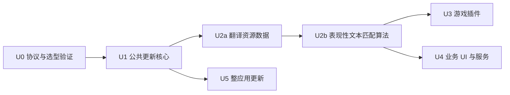

# 应用内分发与更新里程碑

- 日期：2026-10-26
- 文档类型：里程碑，只描述依赖、交付顺序、验收与状态，不替代需求或技术契约。
- 状态：实施中；U0/U1/U2a 已有本地实现与验证，正式发布链路尚未验收，均不标记完成；U2b–U5 待实施。具体记录见 §4。
- 有效范围：GitHub 统一更新基础能力 → 翻译数据与匹配算法 → 游戏插件 → 业务 UI/服务 → 整应用。
- 需求：[应用内分发与更新](../application-updates.md)。
- 技术：[统一更新设计](../technical/application-updates.md)。
- 读取时机：排期、依赖分析和阶段验收；普通功能开发从需求与技术文档进入。

## 1. 总体拆分

统一的是可信发现、下载、版本和状态管理；安装和生效按类型拆分。官方分发固定 GitHub，客户端直连，不经 Vercel 转发。当前只推进 U0、U1、U2a、U2b，后续阶段先确定边界，不作为翻译能力包交付前置。

推荐排期：U0 → U1 → U2a → U2b，数据和算法分别验收。U0 就确定算法接口，U1 准备最小加载基础，避免只做纯数据下载器后再重做。翻译主流程继续随 App 发布。U4、U5 可按需求独立排期；首次获得能力加载器或业务包启动器需要宿主升级，可通过现有人工安装渠道完成，不依赖 U5。

当前执行顺序调整（2026-10-26）：先验收本机 dev server 的本地资源导入、下一批翻译生效与显式回滚，不要求先部署 GitHub、生成正式信任根或接入签名流水线。下表中的真实渠道退出条件保留为生产阶段验收，不能阻塞当前开发，也不能以本地导入验证替代正式渠道验收。算法在开发环境通过源码更新；独立能力包加载仍待后续实现。

交付基线：默认翻译资源与匹配算法随安装包内置，安装即可使用基础能力；GitHub 仅用于后续更新。生产验收须覆盖全新用户数据目录、无网络、无远端更新配置下的首次启动及默认资源命中，不能要求用户先下载基础包。

## 2. 阶段交付

| 阶段              | 交付内容                                                                                                      | 验收与退出条件                                                                                                          | 依赖 / 状态                                               |
| ----------------- | ------------------------------------------------------------------------------------------------------------- | ----------------------------------------------------------------------------------------------------------------------- | --------------------------------------------------------- |
| U0 协议与方案验证 | 固定 GitHub 元数据入口及 Releases 布局、包身份、算法接口、兼容范围、信任根方案；TUF 验证与下载复用清单        | 验证匿名访问、重定向、续传与 App/资源渠道互不干扰；有效目标接受，篡改/过期/远端回退拒绝；离线旧版可用；记录选型结论     | 无；本地协议及 TUF 校验通过，正式源及算法接口实测待补     |
| U1 公共更新核心   | 可信发现、下载校验、独立安装状态、包级互斥、版本目录、恢复、下载中心映射；最小能力加载基础；GitHub 发布流水线 | 验证用包完成两个版本发布/安装；断网、退出、坏包与并发不破坏旧版；安装与启用分离；不重复下载已有内容，不经 Vercel 代理   | U0；核心/API/CLI/离线导入已实现，正式流水线与能力加载待补 |
| U2a 翻译资源包    | 接现有预览/导入/激活；基础离线包、语言对按需下载、固定批次快照、自定义覆盖与回滚                              | 不更新 App 即增加词条并生效；旧批次保持旧版，下一批用新版；用户词条不丢失；GitHub 两版本验证通过                        | U1；资源接线及本地两版本验证通过，管理页面与真实渠道待补  |
| U2b 匹配能力包    | 表现性文本匹配算法独立构建、worker 调用、算法/数据兼容组合、超时回退、版本来源与缓存区分                      | 不更新 App 即更新算法；GitHub 两版本验证；坏算法恢复内置能力或引擎；新旧批次版本隔离且资源/算法一致；吞吐与响应对照通过 | U2a；待开始                                               |
| U3 游戏插件       | MV/RGSS 独立产物与兼容集合；本机包库、按游戏应用、备份/恢复与版本记录                                         | 至少一个实际游戏完成两版本安装升级及失败恢复；修改冲突能识别；验证重启后的加载版本                                      | U2b 后排期；待开始                                        |
| U4 业务 UI 与服务 | 稳定宿主启动选择、完整 Next 业务包、服务健康检查、窗口重载及旧版兜底                                          | 不替换 Electron 即更新界面与匹配服务；坏业务包能恢复；运行任务不被升级强制中断；核验数据迁移可回退边界                  | U1；U2b 后排期，需一次宿主升级；待开始                    |
| U5 整应用         | 专用 App 更新器、平台 feed、合适产物和签名、重启安装、故障引导                                                | 各声明支持的平台分别从已安装旧版升级到新版；保留用户数据；业务服务不可启动仍有恢复入口                                  | U1；独立排期；待开始                                      |

U1 验证用适配器只用于测试协议与恢复，不提供任意脚本安装能力。U4 与 U5 的回退承诺须以实际平台及迁移验证为准。

## 3. 与翻译项目的关系

- 原翻译 M1：直接匹配、表现性文本处理、外置资源与异常积累；原质量/性能验收继续保留。
- 更新 U0/U1：建立官方资源独立分发的前置能力。
- 更新 U2a：将现有资源版本和激活能力接入 GitHub 独立发布渠道。
- 更新 U2b：将匹配算法接入独立加载与更新；现有纯函数文件不是已完成的动态能力包。
- 原翻译 M2 分类与后续模型优化：不需要等待 U3–U5。

不得把本里程碑 U2a/U2b 的“下发成功”作为翻译质量合格的证据，也不得因原翻译 M1 核心实现存在而把 U0–U2b 标记完成。

## 4. 每阶段交付记录

验收时填写：对应代码/发布版本、目标平台、发布源、输入和输出包身份、真实验证步骤、结果及残余限制。未填写验证记录的阶段保持未完成，不因文档写完自动变更状态。

2026-10-26，首个开发增量（本地工作区，未发布）：

- U0：锁定 `tuf-js@4.1.0`，协议 1、宿主 API 1、稳定 SemVer 和官方源边界已落地。临时签名仓库验证合法更新、篡改/无效签名/过期/防回退；真实 GitHub 公开访问与运维责任尚未验收。
- U1：实现可信发现、签名字节数与哈希校验、安装与启用分离、持久意图恢复、单写锁、下载进度映射、API/CLI、离线签名包导入与发布产物准备。正式根与自动签名发布流水线、真实退出/磁盘满场景尚待补齐。
- U2a：本地测试包 `chaya.test-ja-zh` 的 `1.0.0 → 1.1.0 → 本地回滚 1.0.0` 通过；已验证旧批次保留原快照、用户覆盖不丢失和重复安装不重新下载。使用临时目录及测试资源库，不能视为 GitHub 两版本验证。
- 相关 11 个测试套件、155 项测试及 TypeScript/Next 构建通过。具体接口、命令和限制见[技术文档 §8](../technical/application-updates.md#8-首个开发增量更新核心与翻译资源接线)。
- U2b–U5 尚未交付；匹配算法仍随应用发布，不能以本次资源数据接线宣称算法已能独立下发。

2026-10-26，本地开发后续增量：

- dev server 增加资源管理 API，与 CLI 共用存储服务，支持预览、导入、启用/回滚、停用、导出和试匹配；完整页面后续建设。
- 相关 12 套件、166 项测试通过；现有 Next dev 的 GET 返回 200，写入及两版本切换通过临时 HTTP 服务和独立存储进程验证。没有对现有开发服务执行资源写入，也未完成页面交互验收。
- 原质量/性能验收及正式渠道退出条件保持待验收；本增量不将 U0–U2a 整体标记完成。
