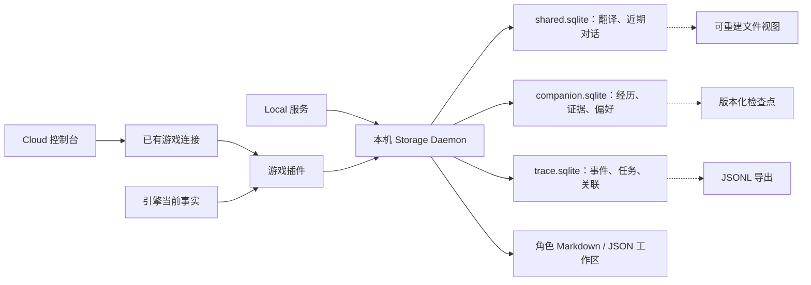

# Agent 与旅伴存储优化技术方案

> 状态：**待实现技术草案**；2026-11-09。已提交代码基线为 `2acd7585`；角色配置另参考同日工作区未提交实现。表名、RPC 名和新增路径均为拟议契约，不表示已建表或已接线。
> 需求：[Agent 与旅伴存储优化需求](../agent-storage-optimization.md)。
> 基线：[存储策略](storage-policy.md) §1–2；保留单实例 Daemon、公共数据根、翻译与旅伴分库及现有运行模式。
> 替代范围：实施后逐项替代 Trace 文件扫描、记忆整份快照写入和角色浏览器权威配置；不覆盖记忆采集、读档关联、授权或引擎存档协议。旧[记忆技术设计](companion-memory.md) §7 的 IndexedDB／文件日志形态是早期设计，当前本机路径以 §2 列出的代码为准。

## 1. 设计决策

1. SQLite 保存需要事务、关联、去重和范围查询的数据；内存只保存当前事实、有界 pending overlay 和可重建缓存。
2. 保留 `shared.sqlite` 与 `companion.sqlite`。Trace 改为 Daemon 管理的独立 `agent-trace/trace.sqlite`，隔离归档生命周期；同一进程内仍需有界调度，分库本身不消除排队。
3. 角色以真实 Markdown / JSON 工作区为权威来源；数据库仅可保存可重建的目录索引。
4. 记忆结构表成为提交与查询真源；完整快照改为带版本、水位的恢复检查点。
5. 对话先保留近期 JSON 文档并解耦视图；长期对话行存储、FTS5 和 LRU 放在后续阶段。
6. 一次本地事务只承诺所属数据库内原子性。Trace、记忆、工作区之间通过稳定来源 ID 关联，不宣称跨库或跨文件原子提交。

## 2. 当前代码与落点

| 职责                    | 当前入口                                                                                                                                                              | 改造边界                                                 |
| ----------------------- | --------------------------------------------------------------------------------------------------------------------------------------------------------------------- | -------------------------------------------------------- |
| Daemon 生命周期与数据库 | [`daemon-service.server.ts`](../../services/storage/daemon-service.server.ts)                                                                                         | 新库生命周期、恢复和调度；不改变连接所有者               |
| RPC、统一队列           | [`rpc.server.ts`](../../services/storage/rpc.server.ts)                                                                                                               | 有界查询、迁移门禁、视图维护和版本检查                   |
| Trace 文件真源          | [`activity-file-store.server.ts`](../../services/game-agent/activity-file-store.server.ts)                                                                            | 改为数据库归档适配；文件转导入源或导出物                 |
| 日志身份、导出与保留    | [`trace.ts`](../../lib/game-agent/trace.ts)                                                                                                                           | 保留来源键、冲突语义和 v2 JSONL 导出                     |
| 记忆表与快照提交        | [`companion-memory-db.ts`](../../services/game-agent/companion-memory-db.ts)、[`companion-store.ts`](../../services/storage/companion-store.ts)                       | 表迁移、增量事务与检查点                                 |
| 战斗记录及统计          | [`companion-recording.ts`](../../services/storage/companion-recording.ts)                                                                                             | 保留当前原子统计及去重；纳入统一预算                     |
| 插件内存与查询          | [`memory-store.ts`](../../lib/game-agent/companion/memory-store.ts)                                                                                                   | 后端有界查询与 pending overlay；不再以全量引导为查询前提 |
| JSON 文档与文件视图     | [`game-store.ts`](../../services/storage/game-store.ts)                                                                                                               | 按 kind 刷新，区分提交与视图结果                         |
| 近期对话                | [`transcript/route.server.ts`](../../app/api/game-agent/transcript/route.server.ts)、[`companion-transcript.ts`](../../components/game-agent/companion-transcript.ts) | 保持上限；卡片属于消息内容                               |
| 当前事实                | [`companion-facts.ts`](../../plugins/mv/src/agent/runtime/companion-facts.ts)                                                                                         | 沿用引擎事实和上下文版本                                 |
| 角色工作区              | 工作区未提交的 `lib/game-agent/roles.ts`、`components/ai/RoleWorkspaceView.tsx`                                                                                       | 尚未进入代码基线；localStorage 字符串迁移至本机文件      |
| 设置与项目 Skills       | [`settings.ts`](../../services/game-agent/settings.ts)、[`skills.ts`](../../services/integration/skills.ts)                                                           | 复用现有来源，不迁移供应商凭据                           |

当前静态路径可确认：Trace 追加调用 `readLines()` 扫描已有文件；记忆 `writeSnapshot()` 删除后重插游戏经历；`game.write` 提交后调用完整 `materialize()`。这些是优化候选，实际耗时由 M0 测量。

角色一行用于记录工作区差距，不作为已提交能力的证据；M2 实施前重新核对实际落地入口。本文不依赖未提交文件或存储策略新增章节才能成立。

## 3. 目标数据流与物理布局



拟议新增路径均相对 `CHAYA_DATA_DIR`：

```text
agent-trace/trace.sqlite
game-agent/roles/<roleId>/
  current.json
  draft/                         # 可选外部编辑草稿，记录 baseRevision
    role.json / *.md / memory/ / skills/
  revisions/<revision>/
    role.json
    AGENTS.md / IDENTITY.md / SOUL.md / USER.md
    memory/*.md
    skills/*.md
```

`roleId` 使用受控稳定 ID；角色显示名不参与路径。现有 `game-agent/settings.json`、`settings.sync.json` 与项目 `skills/<id>/SKILL.md` 维持职责。角色 Skills 不自动覆盖项目 Skills，其挂载规则需要显式接入。

## 4. Trace 数据模型与操作

### 4.1 表和身份

| 拟议表                | 主键 / 唯一键                            | 关键内容                                                            |
| --------------------- | ---------------------------------------- | ------------------------------------------------------------------- |
| `trace_events`        | `event_key` 唯一，`archive_seq` 单调递增 | 来源身份、生产者 epoch / seq、时间、原始事件 JSON、内容指纹、字节数 |
| `trace_event_targets` | `(event_key, game_id, runtime_id)`       | 原始目标、单调 `target_seq`；多个目标不复制正文                     |
| `trace_tasks`         | `task_id`                                | 游戏、运行实例、摘要、状态、更新时间、逻辑占用、版本                |
| `trace_task_events`   | `(task_id, event_key)`                   | 任务关联、taskSeq、单调 `link_seq`、关联内容指纹                    |
| `trace_imports`       | `source_id`                              | 旧文件指纹、已导入偏移、迁移状态和错误                              |

来源事件使用现有 `eventId`；任务专属事件缺少该 ID 时沿用 `traceEventKey(taskId, event)` 的任务序号回退。来源 seq 与 taskSeq 分别保存，不作为全局顺序互换。若后续协议需要命名空间，由版本迁移处理，不能临时更换去重键。

`event_key` 保存原值，不用文件名净化后的字符串替代。冲突判断保持现有 `sameTraceEvent` 语义；指纹只用于加速和迁移校验，不因重新格式化 JSON 放宽同键冲突。

来源原文不可变，原始 `correlation`、`targets`、`seq`／`taskSeq`（如有）原样保留。为另一任务建立关联时单独提交 event_key 和任务上下文，只更新关联行，不在原文上重写 taskId 或序号后再做事件去重。相同任务关联重试需内容相同，异内容冲突。任务分页可从关联行返回任务序号；v2 导出的 `event` 保持原文，通过信封的 `taskId` 表达当前任务关联，不把任务视图重新当作来源正文，也不为旧数据编造未知序号。

### 4.2 追加、关联和分页

1. 校验身份、字段和大小，计算既有契约下的内容指纹。
2. 在单个 Trace 事务内插入事件；已存在则核对内容，异内容返回冲突。
3. 插入目标与任务关联；相同来源重发可补齐缺失关联，不能重复增加计数。
4. 同事务更新任务摘要、字节账本和修订，提交后确认持久化。

索引覆盖任务关联分页、`(game_id, runtime_id, event_key)` 目标筛选、事件时间范围和任务更新时间列表。事件分页使用 keyset 游标，含过滤条件指纹、查询上界 `archive_seq`、所涉关联表的 `link_seq`／`target_seq` 上界和保留代次；不能使用裸时间戳或 OFFSET 扫到深页。旧事件新增任务关联时也生成新 link_seq，不能仅凭旧 archive_seq 混入已开始的分页。关联删除或修改提升相应代次，后续页返回 stale 并重查；任务列表的摘要更新采用同样的版本失效规则。界面显示保留原始时间和生产者序号，时间线的稳定排序策略需与现有行为做回归对比。

新增 `trace.listPage`、`trace.readPage`；默认每页 50 条、最大 200 条，序列化响应最多 256 KiB，单项过大返回摘要与详情引用。旧 `trace.read/list` 调用方一起升级；兼容适配超过总量必须明确返回需分页，不能静默返回截断后冒充完整任务。

### 4.3 保留、导出与故障

- 沿用 `trace.ts` 的 30 天、100 MiB 默认保留起点；新账本计入来源正文、任务关联、索引及必要回执预留，不重复计算共享正文。
- 清理终态任务先删关联；来源事件仍被其他任务引用时保留。无任务来源按运行实例保留策略回收，活动任务不能无限豁免硬容量。
- 回收事件前记录可验证的生产者退休／拒收水位；无法证明旧生产者不可重放时保留最小回执。预算不足时拒绝或降级新日志，并报告缺口，不能删除回执后重新接纳旧事件。
- 导出保持 v2 task/event JSONL 信封；分块读取，受总字节、期限和取消限制。旧内存 `content` 接口仅服务上限内导出，大文件改为受控临时文件或流。
- Trace 写入失败不回滚已发生的游戏动作，也不伪装记忆提交失败；两种归档分别报告状态。

## 5. 记忆增量存储

### 5.1 真源与表结构

保留 manifest、经历、证据、战斗记录、统计和批次回执，补齐可索引的游戏修订、周目、运行实例、分段、遭遇、实体和时间字段。复杂 payload 可继续使用 JSON，筛选字段提升为列；不为拆 JSON 而拆每个叶子字段。

拟议新增或独立化：`companion_preferences`、`companion_save_links`、`companion_projections`、`companion_checkpoints`。经历继续沿用稳定 episode 身份；证据使用持久 evidence ID 或稳定来源组合键，禁止把数组位置作为长期身份。旧记录缺少身份时迁移一次分配映射并保存。

`companion_snapshots` 在迁移前是读取来源；切换后仅作带 `schemaVersion`、`generation`、`memoryEpoch`、`recordingRevision` 和提交水位的检查点。检查点是结构行的一致快照，不是第二条写入仲裁路径。

### 5.2 普通提交

1. 沿用批次 schema 校验和 `BEGIN IMMEDIATE`，核对 batchId、内容指纹、epoch 与 recordingRevision。
2. 按稳定身份读取受影响的少量行，纯归约产生新增、更新、删除及统计增量。
3. 在同事务应用经历、证据、存档关联、偏好、战斗记录与统计；保留同键异内容冲突检查。
4. 用行级字节差量维护预算账本，增加批次回执和 generation；所需容量不足则执行有界裁剪或拒绝该批次。
5. 提交后发布版本和查询失效通知。普通提交不删除重插整游戏，也不重写完整快照。

复杂归约逐项迁移为局部上下文接口；不能只把全量快照计算藏到服务端而宣称完成增量化。全局已用容量由事务账本维护，定期校验；普通写入不扫描全部游戏计算 SUM。

有界裁剪按索引找到最旧可回收细节，限制每轮行数和时间；仍不足时报告容量降级。回执、来源水位和统计基点也计入预算。来源退休前不能按简单 TTL 删除回执。

### 5.3 查询与内存 overlay

新增 `companion.query`，复用现有查询意图及范围规则；优先 B-tree 实体查询。默认结果数量、2000 字符上下文预算、完整度和 linked-load 例外沿用原记忆设计。

返回 `{ items, nextCursor, memoryEpoch, generation, coverage }`。游标绑定范围与版本；清理或版本变化后返回 stale 并重查，不拼接不同代次的结果。单次读取在一致读事务中完成。

`GameplayMemoryStore` 引导只加载管理元数据、偏好和有限热点；查询合并持久行与当前有界 pending overlay，按稳定 ID 去重。未提交记录保留 pending，成功提交才转为 committed。内核现有同步调用必须逐个改接有限视图或异步查询，不能保留“读完整游戏”作为隐藏前提。

### 5.4 检查点与清理

检查点在独立维护任务中生成，沿用现有容量与临时空间约束；中断后丢弃未完成代次。不得在同一 Daemon 串行队列中长期持有快照事务并阻塞普通读写；采用经验证的分段方案，或独立只读连接／工作线程读取固定快照，并测量 WAL 与磁盘增长。

`companion.manage` 继续原子提升 epoch 或 recordingRevision，并删除指定范围。索引、pending overlay、缓存和正在生成的证据上下文随后失效；旧归档和检查点不能自动重新导入。清理记忆不删除 Trace、历史聊天或原生存档。

## 6. 对话与文件视图

### 6.1 M1：保留 JSON 文档，按 kind 刷新

`game.write` 的数据库文档与修订更新仍在一个事务中完成；增加持久的 dirty-kind／视图修订记录。提交后只调度受影响视图：

| 变更                                  | 刷新范围                                       |
| ------------------------------------- | ---------------------------------------------- |
| `agentHistory`、`companionTranscript` | 仅存在公开映射的对应文档；无公开文件则无需物化 |
| 译文变更                              | 对应翻译视图                                   |
| 其他游戏文档                          | 对应 kind 的文件视图                           |
| 缺失视图或迁移修复                    | 按需重建，显式维护任务                         |

`.revision` 不能在仍有旧视图时宣称全部就绪。按 kind 保存已物化修订，或仅在所有必要视图追平后更新总修订；`ensureViews` 同步改用新规则，避免下次 mount 又触发全量刷新。

协议返回区分 `committed` 与 `viewStatus=ready|pending|failed`。文件写入沿用临时文件与原子替换；提交后文件失败仍可重试物化，不重放已提交业务变更。调用端不能把 pending 当作未提交而重复动作。

近期消息、活动各 200 条和 PUT 总量 1 MiB 限制保留。卡片更新增加消息身份和文档 expectedRevision；冲突时重新读取并按卡片状态机合并，不直接用旧文档覆盖已回答状态。卡片答复引起的游戏动作沿用执行层幂等机制，数据库保存本身不触发动作。

### 6.2 M3：长期对话按行保存

只有启用长期保留后，才将该范围对话切换到 `companion.sqlite` 中的会话、消息和卡片行，使用稳定 ID、修订和分页；近期 UI 视图从行数据投影。未启用范围继续使用近期文档，每个会话只能有一个真源。

卡片是消息的结构化附件或关联行，答案变更须遵守版本及状态机。与 Trace 通过 taskId 关联，不复制完整工具轨迹。迁移只覆盖旧文档现存内容，保留原时间和未知来源标记。长期聊天有独立开关、配额及删除语义，不默认扩大既有记忆清理范围。

## 7. 角色文件工作区

### 7.1 提交协议

拟议 `role.read`、`role.commit`、`role.import` 接口通过已有本机通道调用，沿用认证及运行模式门禁：

1. 请求包含 roleId、expectedRevision、mutationId、变更文件及内容指纹。
2. 校验受控相对路径、UTF-8、数量和大小。禁止路径穿越、符号链接逃逸与浏览器提交任意绝对路径。
3. 写入新的不可变 revisions 目录，生成包含各文件指纹与已应用 mutationId 的 manifest。
4. 完成必要 flush 后原子替换 `current.json` 指针；读者只读取它指向的完整代次。
5. 提交后返回 revision 和 appliedRevision／待应用状态；旧代次按备份、回执与容量规则回收。

初始限制建议每文件 256 KiB、每角色 2 MiB、用户全部角色 20 MiB，均包含代次工作空间预留；由实现常量统一定义，在 M0 样例验证后调整。容量不足不先删除当前有效代次。mutationId 相同内容返回原提交；同键异内容冲突。expectedRevision 防止并发覆盖。

外部编辑使用 `draft/`，记录草稿来源 baseRevision；经同一校验和提交协议发布后才进入新修订。已发布 revisions 不直接编辑。浏览器提交或导出草稿时不能覆盖已有外部未提交修改，修订不一致返回冲突。draft 是未发布内容，不是运行时真源；浏览器和磁盘草稿均计入对应容量。

备份复制 current 指向的完整代次及必要元数据，未发布草稿单独标记。运行时读者只消费已验证的已发布修订；保留旧代次不代表自动回滚已提交内容。

### 7.2 localStorage 迁移与运行时

浏览器主动提交 `chaya.ai.roles.v1` 的可预览导入内容；服务端不能自行读取浏览器存储。按旧记录 ID 与内容指纹幂等导入，不覆盖已有较新角色。多个 Origin 或多个版本冲突返回候选，由用户选择；确认新源提交后只标记旧源已迁移，清除由用户或独立清理流程执行。

未连接本机时允许草稿与导出，不能伪报保存。切换角色文件真源前，浏览器所有 `saveAiRole` 调用统一改接服务；禁止后台继续向 localStorage 写权威配置。

工作区 `MEMORY.md` 是人工内容或带来源水位的生成摘要；与数据库经历分别标注，不解析为已观测事实。默认模板中的“初次相遇”“喜欢探索”等文字不自动产生证据或用户偏好。动态台词区分人工模板和可丢弃生成候选，候选有独立容量。

运行时按角色修订读取经验证的内容，记录实际 appliedRevision。文件保存与模型生效分开验收；本阶段不凭 UI 文件树就声称工作区已经挂载。角色文字不改变系统授权、工具权限或事实来源。

## 8. FTS5 与内存缓存（M3）

### 8.1 文本索引

FTS5 只用于需要长期检索的经历摘要、对话正文等；不索引全量状态、工具 JSON 或图片。实体 ID、时间、周目等仍走结构化索引。检索范围、排序与返回预算不能由全文命中绕过。

实施前在实际打包运行时探测 FTS5 及 tokenizer 能力，建立中／日／英样例集。拟比较分词后词元索引和 trigram 子串方案；短于三字符的人名有独立词元／别名索引与精确查询验收，不能只依赖 trigram。复用现有文本归一化需先评估是否损失原文或证据语义。

索引作为可重建派生物，保存 schema、tokenizerVersion、epoch 和覆盖水位；外部内容表的增删改与索引更新必须有一致性机制。小批次同事务维护，重建时按固定代次分段生成，追平后切换。删除屏障立即使旧索引结果不可用。

FTS 不可用或重建期间，返回结构化检索结果并标记 `searchUnavailable`／`partialCoverage`；不得无界 LIKE 扫全库，不将暂时缺少索引解释为没有历史。全文匹配不生成战斗因果或策略结论。

### 8.2 缓存

缓存键按用途包含 gameId、dataRevision、playthroughId、runtimeInstanceId、contextEpoch／factsRevision、memoryEpoch、generation、roleRevision、查询参数及 locale；只加入该结果实际依赖的字段。

每个缓存同时限制条数和字节。初始查询缓存建议每实例 128 项且不超过 2 MiB，进程汇总不超过 16 MiB；多实例达到总额时共享回收，不按实例无限乘增。缓存命中更新最近访问次序，TTL 只补充失效通知。

引擎当前事实不通过缓存取代；事实版本是否覆盖某个派生计算必须逐项确认。管理变更、读档、重连、切换游戏和角色提交清除相关缓存，模型发送前再次校验版本。待写队列和回执不进入普通 LRU。

## 9. 调度、迁移与恢复

### 9.1 Daemon 调度

先在现有调度上标记 queueWait、execute、projection 和 maintenance，再引入批次大小、响应字节和维护时间片上限。日志高峰不允许无界入队；记忆管理屏障与同域提交保序，不因提高优先级跨过前序有效提交。

导出、索引重建、迁移和检查点按分段任务让出执行。独立 Trace 库仍由同一进程持有；只有测量确认同步 SQLite 操作造成阻塞，才将对应处理移入受控工作线程。不能仅将 async 包在同步全量循环外视为完成卸载。

### 9.2 迁移状态机

每个数据域维护 `legacy → importing → verified → active`，错误为 `failed` 且保留旧源。manifest 保存源指纹、schema、进度、校验结果和当前权威代次。

1. 使用项目既有 SQLite 安全备份／切换机制；不能直接复制运行中的主库而漏掉 WAL。若需整库文件替换，必须持有 Daemon guard、暂停受影响库的全部调用并关闭其所有连接，满足 [`atomic-cutover.ts`](../../services/storage/migration/atomic-cutover.ts) 的前提；只冻结某个业务域不足以替换仍被其他域使用的数据库。
2. 旧源继续接收写入时可预导入；最终切换需冻结该域写队列并等待在途写入。仅追加日志可按已验证偏移追平尾部，删除和保留策略另需水位或变更日志；会更新、覆盖或删除的记忆、摘要与对话必须重放完整变更日志（含删除），或在冻结内重读并替换对应范围。没有变化捕获能力时不得只复制新增行；无法在期限内完成重读则取消切换。
3. 记录数、稳定 ID、内容指纹、外键、统计和预算一致后发布 active；解除冻结后只写新源。
4. 冻结超过期限则取消切换、保留旧源继续服务，不长期阻塞游戏。禁止无期限双写。
5. 激活前可回退旧源；激活后已有新提交则只可修复新源，或执行受控反向迁移，不能简单切回旧文件。

Trace 导入同时检查任务文件和来源文件，去重正文并恢复关联；不能只迁移 UI 当前可见事件。损坏尾行与身份冲突进入报告，未处理项必须显示缺口，不能宣布完整迁移。

记忆迁移以当前 `companion_snapshots` 为主源，与结构表、战斗统计和 manifest 交叉校验；不把已裁剪或旧归档内容重新导回。角色采用浏览器主动导入。旧源只保留作受控恢复材料，不在后续启动反复自动导入。

### 9.3 失败结果

| 失败位置                   | 行为                                                   |
| -------------------------- | ------------------------------------------------------ |
| 数据库事务提交前           | 回滚；批次可幂等重试                                   |
| 已提交、客户端未收到确认   | 同 mutationId／batchId 查询或重试，返回原结果          |
| 数据库已提交、文件视图失败 | 标记待重建；后台补齐，不重复业务变更                   |
| 工作区新代次未完成         | current 保持旧值；启动清理未发布代次                   |
| 版本冲突或删除屏障变化     | 拒绝旧请求、丢弃旧缓存，重新取得当前版本               |
| 磁盘不足或配额超限         | 保护已提交数据，报告降级／拒绝；不能回退浏览器权威配置 |
| Trace／FTS 不可用          | 分别报告日志缺口／检索降级；不伪造游戏事实             |

## 10. 实施与验证

| 阶段 | 工作包                                               | 对应验收               |
| ---- | ---------------------------------------------------- | ---------------------- |
| M0   | 固定设备和负载；记录现状；设计可重复的迁移／故障夹具 | A09、A12 基线          |
| M1a  | Trace 表、追加与分页、保留、导出及迁移               | A01、A02、A09、A12     |
| M1b  | 记忆增量归约、后端查询、版本屏障、检查点和容量账本   | A03–A05、A09、A11、A12 |
| M1c  | dirty-kind 视图、调用端提交状态、卡片修订冲突处理    | A06、A07、A12          |
| M2   | 角色文件工作区、版本提交、浏览器导入、运行时生效回执 | A08、A09、A11          |
| M3   | 长期对话、FTS5 分词验证、可重建索引、查询 LRU        | A05、A10–A12           |

验证必须经过真实 RPC 路径，单测直连 SQLite 不能代替 Daemon 排队和投影成本验证：

- 固定一个小数据集与接近现有预算的数据集，在允许配额内比较 N／10N 历史；固定批次大小，记录读写行数、序列化字节和查询计划。
- 覆盖重复重放、同键冲突、多目标事件、多任务关联、相同时间戳、翻页期间给旧事件新增或删除关联、清理期间分页和管理屏障竞争。
- 预导入后分别新增、修改、删除旧源记录再执行切换；核对任务摘要、经历、证据和对话均与最终冻结源一致，无已删除内容复活。
- 在提交前、提交后响应前、视图写入、迁移切换、工作区指针发布处注入中断，验证恢复。
- 混合运行翻译读写、Trace、记忆和视图维护，报告 p50/p95、最大排队、吞吐、RSS、缓存、数据库及 WAL 大小。
- 覆盖 Local 服务、MV/MZ 插件、Cloud 经插件访问、断连和重连；RGSS 仅验证已经具备的存储入口，不宣称新增记忆采集支持。
- M0 记录同设备基线和放行阈值；固定新增批次的普通写入不得随历史总量全量重写，维护成本单独列出。阈值未达标必须解释和处理后再标记阶段完成。

本文仅定义待实现方案。完成文档检查不等于通过上述运行时验收。
