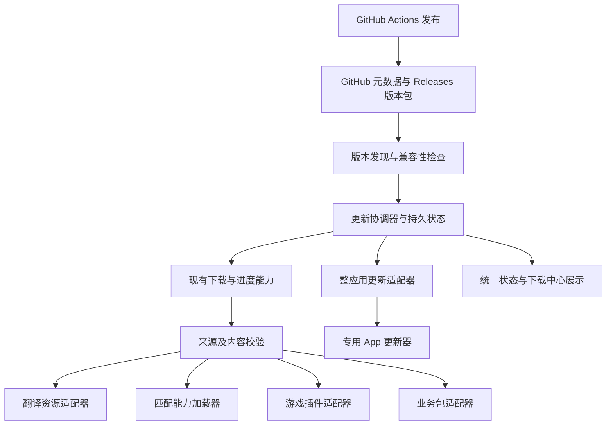

# 统一分发与更新技术设计

- 日期：2026-10-26
- 状态：实施中；§1–7 保留总体设计，当前代码、接口及验证范围以 §8 为准。已锁定 `tuf-js@4.1.0`，尚未完成正式 GitHub 发布验收和匹配算法加载。
- 有效范围：GitHub 固定分发源、本机 local/App 更新基础层、资源与匹配算法适配器；cloud 自身部署不走本机安装器。
- 需求：[应用内分发与更新](../application-updates.md)。
- 排期：[更新里程碑](../milestones/application-updates.md)，仅排期与验收时读取。

## 1. 仓库现状与缺口

2026-10-26 对照源码：

| 已有基础                          | 依据                                             | 仍需补充                                                     |
| --------------------------------- | ------------------------------------------------ | ------------------------------------------------------------ |
| 后台下载任务、SSE、状态快照       | `services/downloads/jobs.ts`                     | 持久安装事务、包版本与启用记录；现有重启中的任务只被标记中断 |
| Range 续传、超时、可选 SHA-256    | `services/downloads/resumable.ts`                | 官方包强制哈希、可信元数据及版本绑定                         |
| 同类型任务复用                    | `startDownloadJob(kind, ...)`                    | 按包身份互斥；不能让两个不同语言包因同 kind 被错误合并       |
| MV/RGSS 独立构建、薄加载器        | `plugins/build.mjs`、`plugins/mv/manifest.json`  | 独立发布源、兼容性与游戏安装版本记录                         |
| 资源版本、导入和激活              | `services/storage/translation-resource-store.ts` | 远程发现与下载、更新协调；保留存储服务单写入口               |
| Electron 启动内置 Next standalone | `electron/main.cjs`                              | 可写业务版本目录、稳定启动恢复器、业务包健康检查             |
| Electron 打包                     | `electron-builder.yml`                           | 更新 feed、平台更新产物及签名流程；当前 `publish: null`      |

下载中心继续遵守现有只读约定。已有 NW.js 下载无哈希时的降级行为不扩展到本方案的官方资源或代码包。

## 2. 推荐架构



统一协议、计划与状态；安装和启用按类型实现。App 更新器可以拥有自己的传输和校验流程，向下载中心映射进度，不要求重复下载同一个 App 安装包。

推荐技术组合：

| 层           | 技术选择                                                                          | 原因与边界                                                                                   |
| ------------ | --------------------------------------------------------------------------------- | -------------------------------------------------------------------------------------------- |
| 更新协调器   | TypeScript + 本地 Node 服务；纯协议/比较逻辑放 `lib/`，I/O 与适配器放 `services/` | 复用当前技术栈；不能让下一阶段业务服务更新器只存在于将被替换的服务内                         |
| 下载         | 复用 `services/downloads`、流式 HTTP/Range、`node:crypto` 哈希                    | 优先扩展现有实现，不重建下载中心；代理、重定向与并发限额需验证                               |
| 发布存储     | 固定 GitHub 元数据入口 + GitHub Releases assets                                   | 客户端直连，首期不接 Vercel 代理、不建设自定义源界面                                         |
| 元数据       | JSON 描述文件、明确协议版本、SemVer 兼容范围、不可变文件名                        | 包、内容格式与宿主接口版本分别管理；不以字符串排序比较版本                                   |
| 可信更新     | 已接入 `tuf-js@4.1.0`；发布端签名工具及流水线待配置                               | 复用签名、到期、防回退与密钥轮换机制；当前版本兼容项目 Node 基线，不把普通哈希等价为来源可信 |
| 本地状态     | 独立 SQLite 更新状态库，单协调写入；文件放可写版本目录                            | 记录事务和恢复阶段，避免依赖短期下载快照；具体 IPC 写入接现有存储约定                        |
| 整应用       | 优先验证 `electron-updater` 与现有 electron-builder 的组合                        | 独立 App 适配器；不能作为语言包、游戏插件的通用安装器                                        |
| 业务 UI/服务 | 版本化 Next standalone 完整产物 + 宿主启动选择与健康检查                          | 先保持前后端构建一致；微前端或 Module Federation 不作为首期依赖                              |
| 匹配算法     | 版本化 JS 能力包 + 稳定调用协议，由宿主管理 worker 生命周期                       | 首期仅官方匹配算法；资源包保持纯数据，不执行安装脚本                                         |

不存在一个下载库能自动满足所有安装场景。公共更新核心负责可信地取得兼容产物；各适配器负责正确安装、启用和恢复。

### 2.1 替代方案与选型门槛

- 全部继续随 App 发布：实现最少，但不解决词条独立更新需求。
- 只有静态 JSON 索引和 SHA-256：能提供发现与完整性检查；不单独满足可信发布、防远端回退和密钥轮换要求。
- TUF 元数据 + 类型安装器：推荐目标，先在 U0 验证客户端运行环境、签名发布、离线行为和运维成本。TUF 负责可信发现和取得文件，不负责安装。
- 手写 Ed25519 签名索引：仅作为 U0 评审的备选。必须明确签名原始字节、信任根、密钥轮换、序号/到期、防回退与事故恢复；未证明等价边界前不直接替代 TUF。
- npm 包管理器：可用于开发期构建，不用来在用户端运行安装脚本或承接 App 安装事务。
- 微前端：仅当后续存在明确 UI 模块独立发布需求时评估；不会自动解决宿主接口与服务端版本匹配。

## 3. 包协议与分发

首期资源采用 UTF-8 JSON/JSONL 内容及描述文件；是否压缩按体积确定。代码包使用适合平台的归档或更新器原生产物，不强制所有类型一种格式。

可信目标描述至少包含：

- `protocolVersion`、`packageId`、`packageVersion`、`kind`、发布渠道与更新说明。
- `contentSchemaVersion`、`hostApiRange`、依赖包版本约束；业务包附带宿主要求与数据迁移兼容范围。
- 源/目标语言，或支持的引擎、OS、架构、运行环境要求。
- 不可变产物定位、字节数与哈希；签名保护全部影响选择和安装的字段。
- `activationPolicy` 的声明值，如下一批、游戏重启、服务重启、App 重启。客户端只接受该类型允许的策略。

不要将“最新 App 版本”作为所有包唯一的版本门槛。兼容旧宿主的新词条包应继续允许独立安装。依赖求解失败时给出原因，不静默升级宿主。

发布过程：构建 → 内容校验 → 上传明确版本的 GitHub Release assets → 验证可下载 → 发布签名元数据。发布端保留可信旧版本供恢复；停止推送坏版本不等于从用户机器删除旧版本。

TUF 元数据有到期与刷新职责，采用静态存储不代表发布端无需维护。U0 须确定定期刷新、签名凭据管理及过期告警的责任；首期只启用 stable 渠道，其他渠道作为协议扩展位。

### 3.1 信任和传输边界

客户端预置可信根；私钥不进入应用。发布流水线使用受限签名凭据，按所选方案规划轮换和吊销。

远端索引过期或校验失败时拒绝新安装，保持本地可用内容。回滚只针对已验证的保留版本并显式记录，不降低已接受的远端元数据版本。

限制文件大小、解压后大小、文件数量与目标目录；拒绝路径穿越、越界符号链接以及未知安装动作。资源包不能携带可执行安装脚本。源和重定向目标由配置的可信发布源策略限制。

### 3.2 GitHub 分发约定

仓库身份沿用 `package.json` 的 `DavidKk/chaya`。以下为拟采用的发布布局，不表示分支、tag 或 asset 已存在：

```text
# 固定元数据根：拟新增 distribution 分支，stable 目录
https://raw.githubusercontent.com/DavidKk/chaya/distribution/stable/

# 版本包：使用明确 release tag 与 asset，版本不可复用
https://github.com/DavidKk/chaya/releases/download/resources-ja-zh-v1.0.0/ja-zh-1.0.0.jsonl
https://github.com/DavidKk/chaya/releases/download/expressive-matcher-v1.0.0/expressive-matcher-1.0.0.zip
```

- 入口固定到 GitHub，不依赖用户访问的站点域名；App 的 localhost 不是发布源。不在 App 首次启动时下载已有的内置资源。
- 元数据目录承载 U0 选定的可信格式；采用 TUF 时发布所需根、timestamp、snapshot、targets 等文件。额外 `index.json` 若存在，仅作辅助目录，不能绕过可信元数据决定安装。
- 元数据中的产物位置明确指向 Releases，不能把相对路径误解析到 raw 元数据目录。客户端在代码上集中定义入口，首期不新增用户配置源功能。
- 包 tag 与现有 App `v*` tag 分开。非 App Release 显式不设为仓库 latest；客户端按固定渠道元数据查包，不依赖 `/releases/latest/download` 或全仓库 latest API。
- 新增发布任务仅响应资源/能力版本或人工发布；不得让翻译资源包 tag 触发现有 App 构建。现有 `.github/workflows/build-app.yml` 的 `v*` 发布行为保持其职责。
- 官方下载必须无需登录。若源码仓库无法公开分发，先明确一个公开分发仓库并统一调整入口，不把 PAT 放入应用。
- 在所有 assets 可匿名下载且哈希核对后，才提交渠道元数据；一组元数据在同一 Git 提交发布。客户端仍须应对缓存导致的不同文件版本短暂不一致，校验失败重试而非绕过检查。
- 包版本不可覆盖；更正内容发布新版本。元数据与普通已发布 assets 是否具有平台级不可变保护须在 U0 核实，不以 Git tag 命名本身保证不可变。
- 优先静态元数据与明确资产 URL，不轮询每个包的 GitHub REST API；做检查间隔与本地缓存，必要时使用条件请求。GitHub 不可达时报告来源和错误，继续使用本地版本。
- 下载器需验证 GitHub 的实际资产重定向、Range 与缓存行为；按实际官方链路约束 HTTPS 重定向，不把 GitHub 下载域名粗略等同于单一 `github.com`。
- local/App 下载在本机 Node 执行；后续浏览器模式若直接读取资源，要另行验证跨域与文件访问能力，不能因此增加 Vercel 大文件代理。

U0 需要一次真实公开访问验证；U1/U2 需要来自该 GitHub 渠道的实际两版本验证。当前仅确定方案，不创建分支、Release 或发布外部产物。

## 4. 本地事务与恢复

建议在 `CHAYA_DATA_DIR` 下新增按用途目录（实施时统一进入路径常量）：

```text
updates/
  state.sqlite
  metadata/
  downloads/
  staging/
  packages/<package-id>/<version>/
```

包 ID 与版本必须先验证，再映射本地目录。版本目录安装后不可变；下载目录和暂存目录不能当作可用包。

状态区分 `checking → available → downloading → verifying → staged → installing → installed → activating → active`；错误另记录发生阶段及可恢复动作，App 等类型可以等待安全重启。

- 下载互斥按包和目标产物，启用互斥按包；写入游戏额外按游戏目录互斥。先支持单个本机数据目录一个协调器，检测并拒绝重复写入者。
- 安装记录保留目标版本、上一可用版本、产物哈希和阶段。重启先核对数据库、文件和适配器状态，再允许新安装。
- 文件改名与数据库提交不是同一原子事务。通过持久意图、暂存、版本指针和幂等恢复处理，不承诺跨文件/数据库天然原子。
- 当前启用版本由各类型的权威存储决定；更新库是协调记录。不得新增另一份会与翻译资源激活表独立漂移的生效指针。
- 清理不得删除当前、上一可用、待恢复事务或运行任务固定引用的版本。原生/整应用回滚遵守迁移兼容性，不套用资源包回滚承诺。

## 5. 类型适配器

### 5.1 翻译资源包：首个交付

验证内容后，通过现有资源存储写入服务执行预览、导入和激活，不直接修改共享 SQLite。将发布端版本身份映射到现有资源包版本，重装同版本必须幂等，不同内容同身份必须拒绝。

批次使用固定资源快照；下一批读取已提交的新版本，旧批次固定版本不变。官方包与用户覆盖层分开，沿用翻译结果来源和版本记录。基础包不再依靠更新源在线可达；现有随构建 JSON 的种子需要产出同协议离线包，保留已安装用户数据。

### 5.1.1 匹配能力包：首期第二步

独立边界是表现性文本匹配器，不包括整个翻译服务。宿主保留已有译文/删除标记保护、格式保护和校验、资源存取、引擎回退、缓存与观察数据记录。

能力包接口以现有纯匹配逻辑为起点，U0 固定协议：

```text
初始化：已验证只读资源快照、协议版本与限制
输入：请求身份、原文、明确语言对、必要匹配上下文
输出：命中译文及条目来源 / 未命中 / 结构化错误
```

宿主按请求校验结果格式、来源身份、输出长度与控制码；能力包不能通过自报结果绕过人工定稿保护。超时或异常终止该 worker，回退已验证内置算法或引擎路径，不能将错误结果作为成功译文缓存。

首期使用 Node worker 承载本机官方 JS 匹配器，隔离计算与生命周期；worker 不是运行不可信代码的安全沙箱。包构建为宿主支持的自包含 JS，不在用户端执行 npm 安装脚本，不授予数据库或下载职责。游戏侧仍走已有宿主查询，不在 U2b 向游戏注入新的独立算法加载器。

资源声明内容格式，能力包声明支持的资源格式与宿主接口。外层发布版本与现有资源 manifest 版本分别映射，不能强行改写历史版本。按任务固定 `(algorithmVersion, resourceRevision)` 组合；更新先验证兼容组合，再供新任务使用，旧任务所用版本继续保留。

同组合复用已初始化 worker 和资源快照，不每条文本重新加载算法或复制全量资源。U2b 对 worker 通信开销、主线程响应和实际吞吐做基线对照；未达到可接受结果不启用远程算法默认路径。

宿主还需为匹配结果来源与派生缓存增加算法身份；现有仅资源版本的记录不能自动证明算法更新后缓存正确。算法激活、崩溃恢复和旧任务版本保留须作为独立验收项。

基础 App 附带可用匹配器与资源。已有用户先安装一次包含加载器的新 App；以后兼容的匹配算法和资源更新无需重装应用。调度、存储或宿主协议不兼容变更继续随 App 更新。

默认资源在构建时通过 `services/translate/resources/defaults.ts` 引入 JSON 数据，匹配器也随宿主构建；`build:translate` 将存储服务所需默认数据打入 worker，Electron 组装时复制 `native/bin`。首次初始化资源库由存储服务在本地写入并启用 `chaya.defaults`，不经过更新协调器或网络；尚无资源库时，读取端通过 `bundledResourceSnapshot()` 使用内置快照。已初始化的资源库保留用户启用、停用与版本选择，不在每次启动时重置。GitHub 仅是后续更新来源，正式根用于验证更新，不是启动内置资源和匹配器的前置条件。以上描述为当前代码路径，安装产物仍需在生产阶段做断网首次启动验收。

### 5.2 游戏插件：后续

先进入本机版本库，再由现有安装流程应用到游戏。MV 的一组相互依赖插件优先作为一致集合发布，避免只更新其中一个破坏接口；RGSS 按平台和引擎区分。

记录每个游戏的安装集合与哈希。预检人工修改、备份和占用，失败恢复游戏旧集合。加载器选择已安装固定版本，不在游戏启动关键路径即时追随远端 latest。开发期热替换不能作为生产无条件热升级的依据。

### 5.3 业务 UI 与服务：后续

当前打包态从 `Resources/app-root` 启动，尚无外置业务版本选择。需要一次宿主升级，加入可信版本选择、启动恢复和内置版本兜底，之后业务包才能独立更新。

先更新完整的 Next standalone 业务产物，包括匹配的 UI、服务与依赖；避免只替换 `.next/static`。后续如拆成纯客户端 UI 包，须先建立稳定 API，并单独验证组件、资源与接口兼容。

稳定启动器管理候选版本：阻止新任务 → 等待或由用户处理运行任务 → 停服务 → 切候选 → 启动并探测带版本身份的健康接口 → 成功确认，否则恢复旧服务。窗口与 SSE 重连；不能直接杀掉正在翻译的任务来完成升级。

`deploymentId` 可辅助版本一致性与刷新，但不能代替版本目录选择、请求路由或安装事务。业务包携带原生依赖时按平台/架构/运行环境构建；不兼容时要求更新宿主。

### 5.4 整应用：后续

专用 App 更新器负责操作系统安装范围和重启安装；公共协调器负责入口、策略及状态映射，避免两个下载器争用同一产物。

优先验证 `electron-updater`，结合当前 Windows NSIS 与 macOS 产物制定 feed 和平台签名流程。当前 macOS ad-hoc/dir 产物不能未经验证便宣称支持自动更新；Linux 若交付，按实际安装格式选择方案并允许引导系统包管理器或人工安装。

若业务服务不可启动，稳定宿主仍需能恢复内置业务版本或显示整应用更新/恢复入口。更新器自身和 preload/IPC 不兼容变更走完整 App 更新。

## 6. 发布与验证

U1/U2 必须验证 GitHub 发布源的两个连续资源版本、两个连续匹配算法版本、断网、损坏、过期/回退元数据、错误平台或接口版本、磁盘满及进程退出恢复。模拟 HTTP 单测不能替代一次实际下载和启用闭环。还需验证已有内容不重复下载、无 Vercel 代理流量，以及算法切换后正确固定新任务组合、旧任务组合和派生缓存。

后续分别补游戏安装恢复、业务服务启动失败回退、整应用各目标平台升级。依赖的数据迁移如果不能向后兼容，应阻止普通回滚，并提供恢复路径。

首期不实现二进制差分补丁、任意依赖自动升级、第三方插件市场、UI 任意代码热加载或整个翻译模块动态更新。公共协议保留适配空间，官方入口固定为 GitHub；任何未来发布源迁移均需经过同一信任和兼容性校验。

## 7. 官方参考与适用边界

方案日期：2026-10-26。官方文档可能对应更新的版本；实施时须对照项目锁定版本验证，不把文档功能当作当前仓库能力。Next 的版本一致性说明已对照本地 `node_modules/next/dist/docs/01-app/03-api-reference/05-config/01-next-config-js/deploymentId.md`；其他依赖仍按阶段验证。

- TUF 官方 Overview：`https://theupdateframework.io/docs/overview/`。用于可信元数据与防回退设计，安装仍由本项目处理。
- Electron 官方 autoUpdater：`https://www.electronjs.org/docs/latest/api/auto-updater`。用于理解平台、签名与安装格式边界，不等于推荐直接替换现有 NSIS 构建。
- Next 官方 deploymentId：`https://nextjs.org/docs/app/api-reference/config/next-config-js/deploymentId`。用于前后端版本一致性设计，不是热更新或安装框架。
- `tuf-js@4.1.0` 已锁定并通过本地签名仓库测试；`electron-updater` 仍为 U5 待验证候选，不能视为已接入。
- GitHub Releases 参考：`https://docs.github.com/en/repositories/releasing-projects-on-github/linking-to-releases`。在线参考查询本轮未成功取得内容，匿名下载、latest 行为、不可变保护及资产重定向以 U0 实测和官方文档复核为准。

## 8. 首个开发增量：更新核心与翻译资源接线

本节为 2026-10-26 实现记录。U0/U1/U2a 已有代码和本地验证，仍不满足整阶段退出条件；U2b 未实现。没有创建正式根、GitHub 分支、Release 或签名凭据，也未完成真实渠道两版本验收。

### 8.1 已有代码与行为

| 部分           | 代码                                                               | 当前行为                                                                                                  |
| -------------- | ------------------------------------------------------------------ | --------------------------------------------------------------------------------------------------------- |
| 固定源及包协议 | `constants/updates.ts`、`lib/updates/protocol.ts`                  | 固定 `DavidKk/chaya` stable 元数据入口和明确版本 asset；验证稳定 SemVer、宿主兼容范围、包身份、大小及哈希 |
| 可信发现       | `services/updates/source.ts`                                       | 通过 TUF 验证元数据；持久缓存保留防回退状态；只信任宿主预置根；拒绝委派 targets                           |
| 传输           | `services/updates/transport.ts`、`services/downloads/resumable.ts` | 官方 HTTPS 地址和受限资产重定向；Range 续传、SHA-256、签名字节数约束；未知大小的响应也在流式读取时限量    |
| 安装状态       | `services/updates/state.ts`、`coordinator.ts`                      | 独立 SQLite 与单写锁；持久安装/启用意图；保留版本、幂等恢复、同身份内容拒绝变更                           |
| 翻译资源适配   | `services/updates/resources.ts`                                    | 走存储服务的预览、仅安装、启用接口；不直接写共享资源库                                                    |
| 下载展示       | `services/downloads/jobs.ts`、现有下载组件                         | 新增 `update-package` 类型；按包与版本复用任务；展示安装完成，启用另行执行                                |
| 离线导入       | `lib/updates/offline.ts`、协调器 `importOffline`                   | 本地包携带签名元数据和内容；继续用宿主根、同一持久 TUF 缓存校验；不能自带替代信任根                       |
| 产物准备       | `services/updates/prepare-release.ts`、`release-cli.ts`            | 生成版本 asset、待签 targets 条目及可选离线文件；不签名、不上传                                           |

协议 1 的实现字段为 `hostApi: { min, max }`，使用含端点的整数区间；当前宿主 API 为 1。`packageVersion` 只接受稳定 `X.Y.Z`，不接受预发布号。`resource: { packId, version }` 映射既有资源 manifest；manifest 版本不要求与外层发布版本相同。

首版只安装 `translation-resource`，要求 `packageId === resource.packId` 且属于 `chaya.` 命名空间；资源内容上限 700000 字节，继续接受资源层原有记录数、格式、占位符等校验。匹配算法类型已在协议中预留，但不会出现在可安装资源列表，也不能安装执行。各语言对通过资源 manifest 和记录声明扩展，下载模块没有语言枚举限制。

更新目录位于 `CHAYA_DATA_DIR/updates/`：

```text
guard.sqlite                          # 跨进程单写锁，不能在运行中删除
state.sqlite                          # 安装状态与审计事件
metadata/                             # 已接受的 TUF 元数据
downloads/<id>-<version>.jsonl         # 下载器还会保留可续传的 partial 文件
staging/<id>-<version>.jsonl
packages/<id>/<version>/content.jsonl  # 保留已验证版本，用于本地启用/回滚
```

数据库持久阶段为 `downloading/installing/installed/activating/error`。下载细分进度继续在下载任务中展示；资源激活表是实际启用状态的权威来源，不在更新库复制生效指针。安装先记录意图再改名，恢复可从下载、暂存或版本目录继续。存储导入失败可复用已验证字节重试；启用暂时失败保留安装状态和旧活动资源，允许离线重试。

安装不会自动启用。显式启用后，已取得资源快照的旧批次仍持有旧快照，新批次读取新版本；官方更新仍沿用用户资源覆盖和人工译文保护。更新过程中不清理旧版本；版本清理策略后续补充。

### 8.2 操作入口

```sh
pnpm updates list
pnpm updates check
pnpm updates install chaya.example-ja-zh 1.0.0
pnpm updates activate chaya.example-ja-zh 1.0.0
pnpm updates rollback chaya.example-ja-zh 1.0.0
pnpm updates import /path/to/offline-update.json

# 准备发布文件；输出目录必须不存在
pnpm updates:prepare /path/to/pack.jsonl 1.0.0 /path/to/new-output
# 已签元数据可附加为第四个参数，生成离线传输文件
pnpm updates:prepare /path/to/pack.jsonl 1.0.0 /path/to/new-output /path/to/signed-metadata
```

以上 `chaya.example-ja-zh` 仅为示例，不代表已发布的真实包。`check/install/import` 需要有效可信元数据；`list/activate/rollback` 不访问远端。重复安装仍刷新可信目录和不可变身份，但不重复下载已验证的已安装内容。

管理 API：`GET /api/updates` 返回本地安装记录及 `active`；`POST` 支持 `action=check/install/activate/rollback`，除 check 外需要 `packageId/version`。安装返回 202 与现有下载任务；API 不接受自定义下载 URL。沿用管理访问校验和本机磁盘能力限制，游戏启动令牌不能获得更新管理权限。离线导入目前走 CLI。

### 8.3 正式源启用前置

- 发布负责人需建立正式 TUF 仓库、签名与轮换/续签职责，并把审核后的公开根放入 `resources/updates/root.json`。Electron 组装脚本已支持复制；当前没有正式根，不能在客户端从网络自动建立信任。
- 运行时缺根会明确拒绝检查/新安装；现有内置翻译和已安装本地版本继续可用。测试只生成临时测试密钥，没有提供冒充正式渠道的根。
- 发布产物准备命令生成 `resources-` 前缀 tag 和 targets 条目，发布时必须设为非 latest。它不等于完整签名流水线；签名、上传、匿名下载核对和原子提交元数据仍待接入。
- 发布目录和离线元数据的签名有效性最终由接收端验证。打包离线文件不会自动信任发布端输入。

### 8.4 已验证与剩余验收

本地回归已覆盖两个资源版本的安装/启用、快照隔离和离线回滚，重复安装与身份冲突、坏哈希/错误 manifest、宿主不兼容、安装和启用意图恢复、单写互斥、用户覆盖保留；临时签名 TUF 仓库覆盖合法更新、无效签名、篡改、过期、防回退、无根拒绝与离线导入。下载测试使用本机 HTTP 服务验证续传和字节数边界；管理 API 测试验证离线读取、后台安装与访问限制。

2026-10-26：相关 11 个测试套件、155 项测试通过；`tsc --noEmit` 及 `pnpm build:next` 通过，包含翻译 worker 构建。该结论限于本地测试和构建，没有实际 GitHub 下载、Electron 安装包或 UI 交互验收。

剩余：正式签名发布流水线、GitHub 两连续版本真实下载/启用、管理页面入口、磁盘满与实际杀进程验收、基础包同协议离线产物、U2b worker 加载/回退/算法来源与性能对照。游戏插件、业务包、整应用更新按 U3–U5 后续处理。

### 8.5 当前优先：dev server 本地资源开发

2026-10-26 调整实施顺序：当前只推进本机开发验证，生产阶段才启用上述 GitHub 分发与签名发布链路。开发环境直接使用资源管理 CLI，无需正式根、Release 或下载服务；保留生产更新器的校验，不增加开发模式免签开关。

先准备资源 JSONL，格式见[翻译资源技术文档 §10.3](translation-game-special-classification.md#103-操作示例)。以下命令在仓库根执行，两个终端使用相同数据目录：

```sh
# 终端一：启动本机开发服务及 worker watch
CHAYA_DATA_DIR="$PWD/data/dev-resources" pnpm dev:loopback

# 终端二：本地预览并导入新版本；首次导入时启用
CHAYA_DATA_DIR="$PWD/data/dev-resources" pnpm translate:resources import /path/to/pack.jsonl
CHAYA_DATA_DIR="$PWD/data/dev-resources" pnpm translate:resources list
CHAYA_DATA_DIR="$PWD/data/dev-resources" pnpm translate:resources lookup ja zh 'ああ'

# 已导入版本重新启用或回滚，不访问远端
CHAYA_DATA_DIR="$PWD/data/dev-resources" pnpm translate:resources activate demo.ja-zh 1
```

`import` 对同一份有界文件依次执行 `resources.preview` 和 `resources.apply`，新版本导入与启用在存储服务事务内完成。修改词条时递增 manifest 的 `version`；同版本不同内容仍拒绝，重复导入已有版本不改变启用状态。当前运行的批次保留旧快照，下一批读取新 revision，无需重启 Next。只修改磁盘 JSONL 不会自动导入，需再次执行命令；已有人工译文和静态导出不会随资源更新自动改写。

开发算法继续通过源码与现有 worker watch 更新；这不代表生产环境已支持算法包动态加载。本地导入走共享资源库，不出现在官方更新器的安装记录或下载中心。生产阶段再验收签名、GitHub 下载与分发恢复。

本地验证记录：使用临时数据目录、真实 storage daemon 和独立 CLI 进程完成 `import → lookup → 导入版本 2 → activate 版本 1`；确认新快照切换、旧快照保持和同版本不同内容拒绝。本次未启动 Next 页面进行浏览器交互验收。

### 8.6 dev server 资源管理 API

`app/api/translation-resources/route.server.ts` 提供本机资源管理入口，复用 `resources.*` 存储 RPC，不访问远端更新源。管理鉴权和 `requireDisk()` 在读取请求体及调用存储前执行；Cloud 构建不包含此路由。

| 请求                                        | 参数                                                                             | 返回                                                 |
| ------------------------------------------- | -------------------------------------------------------------------------------- | ---------------------------------------------------- |
| `GET /api/translation-resources`            | 无，或 `action=list`                                                             | `{ ok, packages }`，含版本及 `active`                |
| `GET ?action=export&packId=...&version=...` | 已存在的包 ID、版本                                                              | 原始规范化 JSONL，`application/x-ndjson`             |
| `POST`，`action=preview`                    | `content`，JSONL 字符串                                                          | `{ ok, preview }`，包含冲突、revision、token；不写入 |
| `POST`，`action=apply`                      | `content`、`token`                                                               | `{ ok, result }`；过期 token 拒绝                    |
| `POST`，`action=import`                     | `content`                                                                        | 对同一内容预览并应用；新版本导入即启用               |
| `POST`，`action=activate/rollback`          | `packId`、`version`                                                              | 显式启用已存在的本地版本                             |
| `POST`，`action=disable`                    | `packId`                                                                         | 停用包，保留已存版本                                 |
| `POST`，`action=lookup`                     | `sourceLanguage`、`targetLanguage`、`text`，可选 `gameId/category/speaker/scene` | `{ ok, revision, hit }`；未命中为 `null`             |

POST 请求体为 JSON 对象。JSONL 的 UTF-8 内容上限仍为 700,000 字节；HTTP 请求在流式读取时另按 JSON 转义最坏膨胀限制总字节数，不信任 `Content-Length`。不接受服务器路径和自定义下载地址；未知操作与非法数据返回 400。导出成功返回 JSONL，其余成功返回统一 JSON 信封；响应不缓存。

`import` 与 CLI 一致：重复导入旧版本不会重新启用，需显式 `activate/rollback`；回滚与启用使用相同资源事务。`lookup` 仅对当前快照试匹配，返回条目来源，不调用机翻或改写缓存。CLI 与 API 的任何版本切换都只影响之后取得的快照。

2026-10-26 验证记录：相关 12 个套件、166 项测试通过，包含新增接口的 11 项测试；TypeScript、针对新增代码的 ESLint 和格式检查通过。现有 Next dev server 的资源列表 GET 实际返回 200。写入验证使用临时 HTTP 服务调用相同路由处理器及独立 storage daemon，完成两版本导入、预览过期拒绝、快照隔离、回滚、不可变版本拒绝、导出、停用及跨源拒绝；测试数据与现有开发服务隔离。未在现有 Next 实例上执行写入操作，未进行管理页面交互验收。
