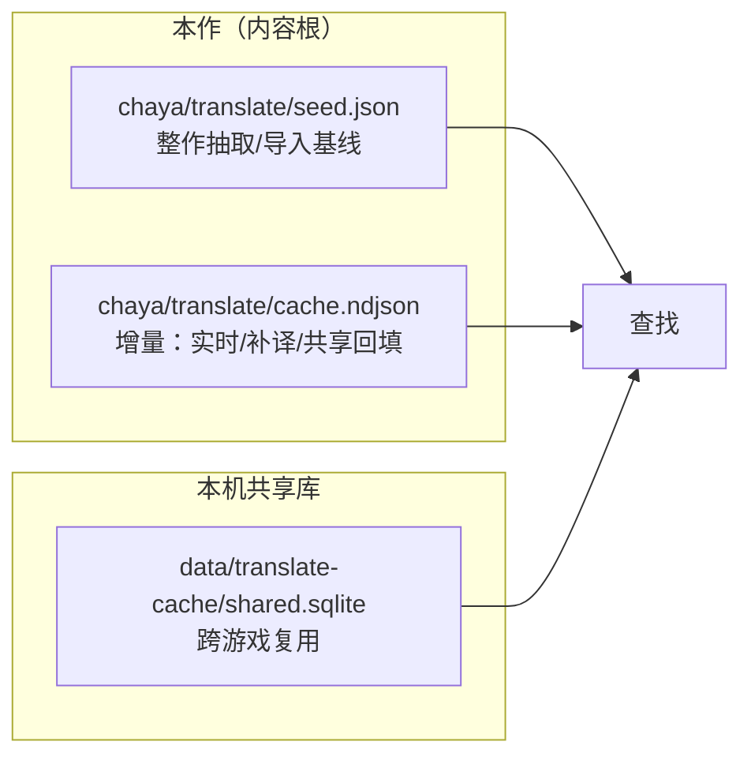
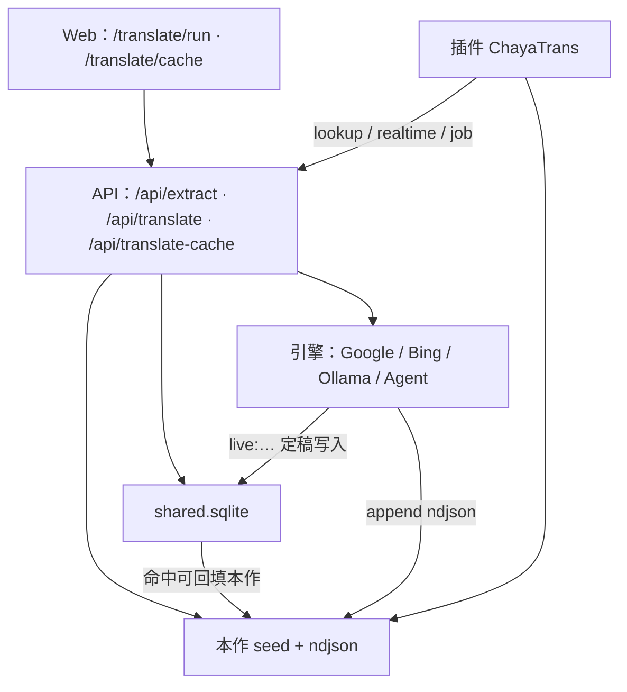
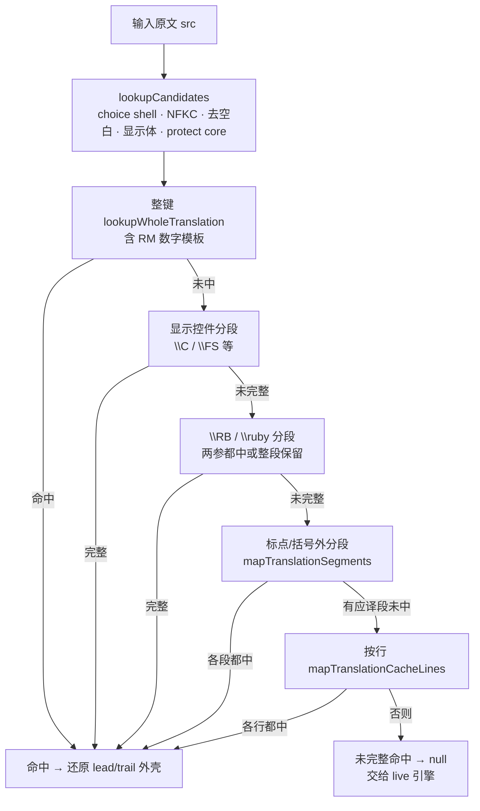
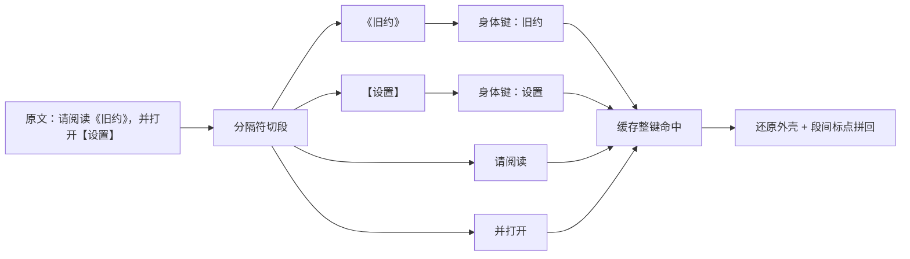
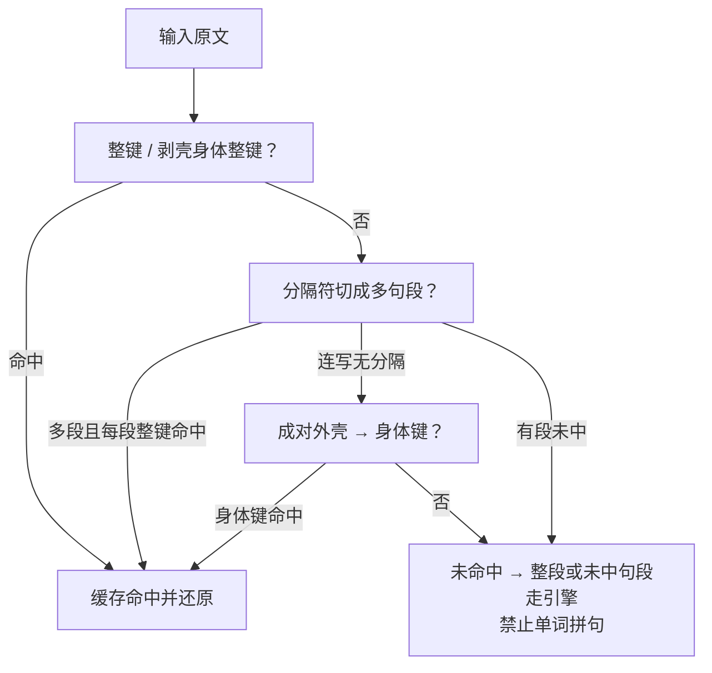
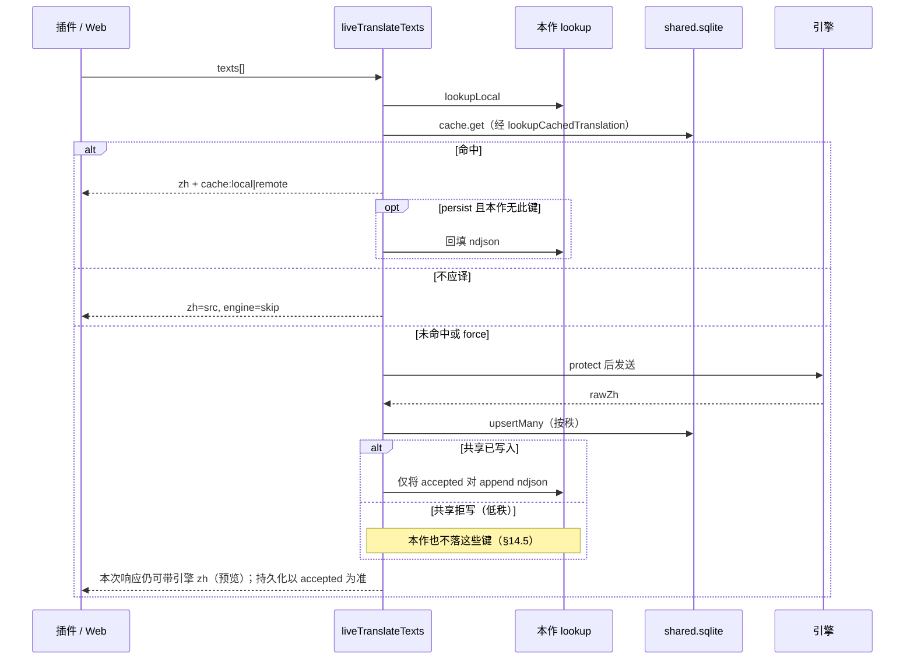
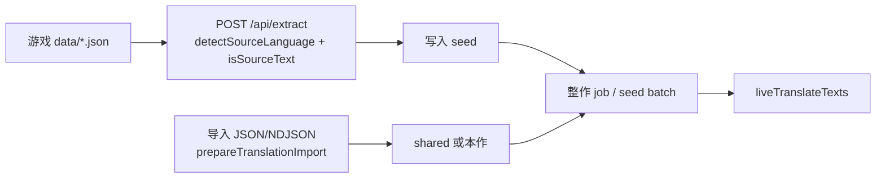

# 翻译体系（现状与缓存演进方案）

- **状态**：§1–13 记录接口、存储与兼容路径；**§14 为原始定稿 + 可重建匹配索引 + 连续短句区间复用方案**。核心已接入服务端与插件，实际接线及后续扩展见 §14.9；目标规则不等于所有扩展都已完成。
- **范围**：抽取 → 入库 / 导入 → 查找命中 → 实时补译 → 局内渲染；以及共享翻译库图鉴。
- **主要代码**：`services/translate/`、`lib/translate/`、`plugins/src/translator/`、`app/api/translate*`、`components/translate/`。
- **待实施补充**：[语义分段优化需求](../translation-cache-optimization.md)与[技术方案](translation-cache-optimization.md)。针对真实对白修正“换行即独立短句”的假设，并统一优化预览与运行时边界；涉及换行和可信分段的后续目标以补充方案为准。

---

## 1. 一句话

**原始定稿保留；本作人工区间先保护，整段优先，随后按连续短句块复用，共享 SQLite 补洞，只对未覆盖区间补译。** 命中规划见 §14.6，控制码 / Ruby 兼容路径见 §6.0；组合结果不冒充新整段定稿。

局内三种游玩模式只改变「何时替换 / 是否显示字幕」，不改变上述查找顺序。

---

## 2. 翻译 vs 缓存（必须分开）

这是两套职责，不要混成「一律去标点」或「一律整句」。

|             | **翻译 / 导出**                                                       | **缓存查库**                                               |
| ----------- | --------------------------------------------------------------------- | ---------------------------------------------------------- |
| 目的        | 给人、给引擎看懂上下文                                                | 机器复用已有译文                                           |
| 标点 / 括号 | **默认保留**（`【加速度】`、句号、逗号都带着）                        | 查库时可剥成对外壳再还原；**不改变**送译原文               |
| 只拆什么    | **游戏特定标记**：`\C`、`\FS`、`\RB`/`\ruby`、选项条件壳、RM 控制码等 | 同上作为分段边界；另有成对括号外壳、空白折叠等**安全别名** |
| 导出 key    | 尽量接近游戏可见串，方便手翻                                          | 定稿入库可用「身体键」提高命中，见 §6 / §12                |
| 部分命中    | 见下方「两条查找路径」                                                | 见下方「两条查找路径」                                     |

**两条查找路径（勿混为一谈）**

| 路径                 | 代码                                                                   | 部分命中行为                                                                                                                              |
| -------------------- | ---------------------------------------------------------------------- | ----------------------------------------------------------------------------------------------------------------------------------------- |
| **兼容完整查找接口** | `lookupCachedTranslation`（`cache-lookup.ts`）                         | 显示分段 / 标点切段 / 按行须 **各应译段都中** 才返回；否则 `null` → 整段交引擎。连写 `abc` **禁止**用 a+b+c 硬拼（§6.3）                  |
| **插件局内套用**     | `translateWithLookup`（`lib/translate/lookup.ts`，经 `lookup-enrich`） | **允许部分替换**：已命中的子段先换上，未命中保留原文。例：`\C[2]回復\C[0]する` 仅有 `回復`→`恢复` 时得到 `\C[2]恢复\C[0]する`（测试锁定） |

**新管线**：服务端 `cache.plan` 与插件 runtime 使用 full / partial / miss；partial 保留已命中块并补译缺口，渲染仍追踪未完成部分。送译和导出保留标点，不把部分结果写成整段定稿。

---

## 3. 游玩模式

| 模式                   | 配置                  | 行为（插件）                                       |
| ---------------------- | --------------------- | -------------------------------------------------- |
| 预翻译 `pretranslated` | `TranslationPlayMode` | 主要靠本地 seed/ndjson + DB/地图补丁；缺词可异步补 |
| 实时 `realtime`        | 同上                  | 对话缺词请求服务端/本机实时翻译，替换正文          |
| 字幕 `subtitle`        | 同上                  | 原文保留，译文走字幕叠层                           |

定义：`lib/translate/play-settings.ts`。插件入口：`plugins/src/translator/`（`dialogue-subtitles` / `realtime-client` / `db-patch`）。

---

## 4. 两套存储

| 库         | 路径常量                     | 键                                                                       | 用途                                                                 |
| ---------- | ---------------------------- | ------------------------------------------------------------------------ | -------------------------------------------------------------------- |
| Seed       | `gameContentRelPath('seed')` | `原文 → 译文` JSON                                                       | 抽取 / 导入基线                                                      |
| 本作 cache | `cacheNdjson`                | NDJSON `[src, zh]` 或 `{s,t}`；`t:null` 删键                             | 增量，覆盖 seed                                                      |
| 共享 cache | `TRANSLATE_CACHE_DB_PATH`    | 复合主键 `(src, src_lang, tgt_lang)`；正文列仍名 `zh`；`engine` 标记来源 | 跨游戏平铺（**无 parent 关联**）；**不收原文=译文**；优化拆段见 §9.1 |

加载本作 lookup：`loadGameTranslateLookup`（先 seed，再 ndjson 覆盖）。
共享读写：`openSharedCache` / `services/translate/cache-api.ts`。

**语言对（图鉴）**：行带 `from`/`to`（`ja|en|zh|ko`）。筛选两边都选时按 **无序对** 匹配（A→B 与 B→A）。查库默认对仍是 `ja→zh`，直至运行时显式传对。旧数据迁移默认 `to=zh`，源侧英文可标 `en`。

---

## 5. 总览

---

## 6. 查找管线（命中复用核心）

入口：

- **兼容完整命中**：`lookupCachedTranslation` / `lookupGameTranslation`（`services/translate/cache-lookup.ts`）——本节顺序与「须完整」均指此路径。
- **插件渐进替换**：`translateWithLookup`（§2）；**不**要求整段覆盖才返回，也 **不** 走本节 flowchart 的「未完整 → null → 引擎」。

### 6.0 兼容查找顺序（控制码 / Ruby 等）

**库源顺序**（`lookupGameTranslation`）：

1. **本作** local（seed → ndjson 覆盖后的 lookup）
2. **共享** shared.sqlite
3. **game-terms** 内置词表
4. 仍未中 → **live 引擎**（定稿后再写回 cache）

> **插件 enrich 不改主序**：`lookup-enrich`（尾缀数字族、glossary 等）在本作索引 / 写库侧增强可命中键，live 查找仍走上面 1→4，不把 enrich 插成单独库源。

**单库内键匹配顺序**（`lookupCachedTranslation`，对本作 / 共享各自跑一遍）：

1. **整键** `lookupWholeTranslation`：对 `lookupCandidates` 逐个试（含 RM 数字模板）
   - 候选大致为：原文 core → NFKC → 去首尾空白 → 显示体 / 剥壳身体 → protect core（及各自 NFKC）
   - 命中后还原 choice / 外壳 lead·trail
2. **显示控件分段** `\C` / `\FS` 等（各子段递归查；须完整才算命中）
3. **Ruby 分段** `\RB` / `\ruby`（两参都中或整段保留）
4. **标点 / 括号外切段** `mapTranslationSegments`（**每一应译段都须整键命中**，见 §6.3）
5. **按行** `mapTranslationCacheLines`（同上，全行都中才算）
6. 否则 → `null`（本库未命中）

**历史 whitespace / coverage（已退出正式命中路径）**：

| 允许                                                                                                  | 不允许                                                                       |
| ----------------------------------------------------------------------------------------------------- | ---------------------------------------------------------------------------- |
| 空白折叠别名（`来店\\n　する` ↔ `来店する`）                                                          | 编辑距离 / 模糊前后缀                                                        |
| **完整覆盖**：输入被 **连续、无歧义** 的已缓存 token 序列铺满（`coverage-lookup`；单段 token 数 ≥ 2） | 无分隔连写 `abc` 靠单字/单词 a+b+c 硬拼（产品硬规则 §6.3；收紧见 §12.2 #12） |

图鉴「优化」写入的子项（身体键 / 拆段键）落在第 1 步整键（及剥壳身体候选）上补洞；**不会**改变上述顺序，也**不会**让半截子项拼出未入库的母句连写。

> 上图仅描述 **`lookupCachedTranslation`**。插件 `translateWithLookup` 在对应步骤会留下已替换片段，见 §2。

### 6.1 外壳与分段（查库侧）

- **成对括号外壳（查库）**：`translationSegmentContent` 可剥 `【】「」『』<>()（）` 等，用身体键命中后再还原外壳。这不改变「送引擎 / 导出」仍带括号的原则（§2）。
- **边界 RM / 装饰**：`peelProtectShell` / `protectForTranslate` 发引擎前保护控制码；入库写身体，局内可还原壳。
- **Whitespace / coverage**：见 §6.0 表；实现 `createWhitespaceLookup` / `createCoverageLookup`。

### 6.2 入库资格

| 函数                    | 用途                                                                                   |
| ----------------------- | -------------------------------------------------------------------------------------- |
| `shouldTranslate`       | 是否值得送引擎（含英日等源语判断）                                                     |
| `isStorableTranslation` | 实时定稿能否进 **共享/live**（默认要求译文含汉字等；**拒原文=译文**）                  |
| `isReusableTranslation` | 查找可用；允许部分「原文=译文」的标签类（**本作 ndjson / seed** 可用，共享库写入不用） |

**共享库额外硬规则**：`isSharedIdenticalPair`（含 `normalizeTranslateKey` 去引号噪声）为真则 **拒写**；打开库时 `scrubDirty` **删除历史同类行**。

**共享写入已接入统一秩保护。** 秩表、确定等价组保护、人工重叠区间保护与 accepted 双写均以 §14.5 为唯一规则来源，这里不重复维护。

当前图鉴按 Import / Agent / Google / Bing 粗分类（`cache-engine-kind.ts`）。修改译文的 PATCH 已传 `manual`；仅改 NSFW 不升级翻译来源。

### 6.3 当前缓存套用与目标差异

本节分段图与全中策略描述兼容完整查找接口；新主路径已按 §14 扩展为连续短句块复用和缺口补译，禁止单词拼句的约束继续保留。

#### 最小短句规则

**连写的一整段原文，必须缓存里有这一整段（整键 / 剥壳后的同一身体），才算缓存命中。**

- 库里只有 `a`、`b`、`c`，原文是一整段 `abc` → **不翻译成「用缓存拼出来」**；当作 **未命中**，整段走引擎（或人翻）。
- 原因与业界一致：词条拼接不能保证语序与语义（如 `who am i` ≠ 字面拼词）。术语/单词级缓存 **不能** 代替句段级 TM。
- **必须**库中有 `abc`（或其合法剥壳等价身体）才直接用缓存。

「合法分段」只来自下面两类边界，**不是**把连写 `abc` 拆成 a+b+c。

#### A. 分隔符切句段（逗号 / 句号等）

跨语言里，停顿类标点可作为 **句段边界**，切开后 **每段单独整键缓存**：

| 分隔符（示意）    | 作用                   | 代码                         |
| ----------------- | ---------------------- | ---------------------------- |
| `,` `，`          | 逗号停顿               | 已有                         |
| `.` `。` `．`     | 句号停顿               | 已有                         |
| `!` `！` `?` `？` | 问叹停顿               | 已有                         |
| `;` `；`          | 分号停顿               | **尚未**并入切段（§12.2 #1） |
| 游戏控件          | `\C`、`\FS` 等显示控制 | 已有                         |

流程：

1. 大段原文例如 `abc,def；ghi。`
2. 切成句段：`abc` / `def` / `ghi`（分隔符留在段间，拼回时还原）
3. 缓存分别存整段 `abc`、`def`、`ghi`（各是一条 TM）
4. 查找时各段整键命中才拼回；任一应译段未中 → 整句未完整命中（不得用更碎的词硬拼）

与硬规则不矛盾：有分隔符后已是多句段；**每个句段内部**仍须整键命中（段内连写 `abc` 仍不能靠 a+b+c）。

以上为当前完整命中路径。**目标方案改为返回短句区间匹配计划**：保留已命中的连续块，只对未覆盖区间补译；不再因一段缺失丢弃其它缓存结果，见 §14.6。

#### B. 成对包裹抽「中间身体」做独立缓存

书名号、方头括号、引号等 **成对外壳**，中间正文可抽成独立缓存键：

| 外壳（示意）        | 身体键（入库 / 查库） | 还原              |
| ------------------- | --------------------- | ----------------- |
| `《书名》`          | `书名`                | 命中后加回 `《》` |
| `【标签】`          | `标签`                | 加回 `【】`       |
| `「台词」` `『…』`  | 中间正文              | 加回原引号        |
| `（补充）` `(note)` | 中间正文              | 加回原括号        |
| `<提示>`            | 中间正文              | 加回 `<>`         |

规则：

1. **外壳内不再按逗号切开**（书名、标签保持一块）。
2. 缓存优先存 **身体键**；同一身体被多种外壳包住时共用一条。
3. **送译 / 导出** 仍可用带外壳的完整串（§2），方便人翻；查库时剥壳命中身体。
4. **运行时查库**成对剥壳走 `translationSegmentContent`（侧重成对）；**图鉴优化**另有单侧壳 / 边角 junk 剥法（`optimize-segments`，§9.1），二者勿混为一谈。

#### C. 「缓存去标点」在本阶段的含义

| 做                                | 不做                               |
| --------------------------------- | ---------------------------------- |
| 用分隔符 **切句段**，段间标点还原 | 把段内文字去光再拼句               |
| 成对外壳 **剥开存身体、显示还原** | 导出/送译强制改成无标点裸串        |
| 每句段 / 每身体 **整键** 命中     | a+b+c 拼连写句段；书名号内再切逗号 |

#### 例：连写 vs 分隔 vs 包裹

下图是 **产品规则示意**（连写 / 分隔 / 包裹），不是 §6.0 的完整代码路径（代码里剥壳身体含在整键候选里，且还有显示分段与 ruby）。

| 情况                                                                      | 结果                                 |
| ------------------------------------------------------------------------- | ------------------------------------ |
| 原文 `abc`，库有整段 `abc`                                                | 直接用                               |
| 原文 `abc`，库仅有 `a`/`b`/`c`                                            | **不拼** → 整段进引擎                |
| 原文 `abc,def`，库有 `abc`、`def`                                         | 逗号切段，各段整键 → 拼回            |
| 原文 `abc。def！ghi`，库三段齐全                                          | 句号/叹号切段 → 拼回（分号待 §12.2） |
| 原文 `《旧约》`，库有身体 `旧约`                                          | 剥壳命中 → 还原 `《》`               |
| 原文 `请看《旧约》，再开【设置】`，库有 `请看` / `旧约` / `再开` / `设置` | 分隔 + 包裹身体均整键 → 拼回         |
| 原文 `abcdefghijk`，无分隔、库无整段                                      | → 整段进引擎                         |

**兼容代码**：分隔切段、成对剥壳、分段全中才返回仍在 `segments` / `cache-lookup`；旧词级 coverage helper 保留供独立测试，正式查找不再调用。新 full / partial / miss 规划见 §14。

**目标变化**：允许按完整短句覆盖占比选择复用块（§14），部分覆盖仍不是整段定稿。其它未做项：边角 `+`/`-` 等非成对尾缀统一进 **运行时** 剥壳（图鉴优化路径已有 Unicode 边角 junk / 单侧壳）。

### 6.4 标点与规范匹配键（目标方案）

**原文 `src` 不变；规范键只进入匹配索引**（§14），不再迁移为规范化主键。

标点同时承担「切分边界」与「语气标记」两种职责。全半角可以等价；无句末标点、陈述句号、感叹号、问号、混合问叹分别保留，不能一律去标点后命中。同类重复问叹可折叠为最多两个；`?!` 与 `!?` 保留先后次序。

整段优先；未整段命中时，优先复用连续多短句块，再尝试单短句。不是按单词或任意子串匹配。

### 6.5 换行与句段（目标方案）

保留原始 `src` / `zh`，索引记录换行性质：

| 换行                       | 匹配处理                                             |
| -------------------------- | ---------------------------------------------------- |
| 明确的排版软折行           | 不是短句边界；日文可删除，空格语言仅在词间收为单空格 |
| 硬换行 / 列表 / 独立对话行 | 保留边界，可分短句；不能跨结构块拼接                 |
| 性质不明                   | 保留，默认按独立行处理；不得猜测为软折行             |
| `\n[1]` / `\N[1]` 等控件   | 先识别为完整控件，不作为换行                         |

英文词中折断只有导入元数据明确支持时才连接；未知折行不按去空白等价。字面转义换行按文件格式解码一次，不二次解码可见反斜杠。命中不套原文折点，也不删除译文换行；排版能力独立于缓存命中。

---

## 7. 实时补译（miss → 引擎 → 双写）

下图概述 accepted 双写；部分命中先按 §14.6 补缺口，只有引擎新译块进入定稿，组合结果保持派生。

要点（`services/translate/live-translate.ts`）：

1. 去重，单批上限 40。
2. `force` 跳过查找（重新翻译）；**仍受写入秩约束**（§14.5）。
3. `persist:false` 只预览不写库。
4. 敏感文本仅 Agent（`engineAcceptsSensitive`）。
5. 定稿键尽量用 **无边界壳的 body**；选项条件壳查找时剥开，避免把 `if(...)` 译成散文。
6. **双写与拒写**：`writeMany` 返回 accepted / rejected，只有 accepted 定稿排入带来源的本作回填；低秩拒写不会污染本作。旧 `upsertMany` 计数接口保留用于兼容。

---

## 8. 抽取 / 导入 / 整作补译

- **抽取**：按源语过滤可译字符串 → seed；源语 `ja|en|zh`（`lib/translate/source-text.ts`）。英文源与日文一样可进 live（`shouldTranslate`）。
- **导入**：对齐/剥离后写入共享或本作；`import:` 引擎 tag。
- **整作补译**：对 seed 缺词分批 `liveTranslateTexts`。

---

## 9. 共享翻译库图鉴（Web）

- 路由：`/translate/cache`（**不需绑定游戏**）；run 页仍要绑定。
- 筛选：原文语言 / 译文语言（成对时双向）、引擎种类、NSFW 三态、实时/非实时。
- 列：原文、译文、语言对、引擎（+ Live 标记）、命中、更新、操作。
- CRUD：`GET/POST/PATCH/DELETE /api/translate-cache`。

### 9.1 图鉴优化：当前实现与目标

**当前实现**：

- 单行详情入口 `/translate/cache/detail/{rowid}`（编辑译文 + 优化同页）；确认请求携带原始 `parent.src/zh` 与审阅后的 pairs。
- `POST /api/translate-cache/optimize` 验证原始定稿未变化，只把原译各自唯一、完整的短句区间保存为 verified 映射；不批量创建子定稿。歧义 / 结构不匹配计 conflict；旧原文快照返回 409。
- 母句保留，修改译文的 PATCH 仍升 manual；旧 `upsertOptimizeMany` 仅作为低级兼容接口保留并守秩，现图鉴已切换到确认映射。

**采用 §14，不再通过大量拆段定稿来提高命中**：

| 操作                           | 目标行为                                         |
| ------------------------------ | ------------------------------------------------ |
| 自动剥壳 / 安全拆段            | 建匹配索引，引用原始定稿与可用译文区间           |
| 缓存含 `a,b,c`，画面显示 `b,c` | 有原译映射时提取完整连续块；无映射继续查其它候选 |
| 画面含 `a,b,c`，缓存只有 `b,c` | 整块复用，缺口 `a` 补译                          |
| 只找到独立 `b` / `c`           | 以完整短句组装，保留边界；不允许词级拼接         |
| 人工确认一条独立译文           | 新建定稿或手改并标 `manual`，按写入秩保护        |
| 不同定稿派生出同键异译         | 保留歧义，有作用域 / 明确来源才消歧，否则回退    |
| 原文=译文标签                  | 共享拒写，仍允许本作合法标签                     |
| 修改 / 删除原始定稿            | 派生索引与带来源回填失效                         |

没有母子翻译树；索引保留来源及区间用于提取 / 失效。短句不因字数少就禁止匹配，但必须是完整短句、语气相容且无异译歧义。历史 optimize 独立记录仍可读，批量优化与诊断界面后续补齐。

---

## 10. 插件侧职责摘要

| 模块                        | 职责                           |
| --------------------------- | ------------------------------ |
| `runtime/store`             | 读 seed/ndjson，热更新         |
| `lookup/lookup-enrich`      | 尾缀数字、glossary、专名索引   |
| `patch/db-patch`            | 预翻译改 `$data*`              |
| `engine/dialogue-subtitles` | 实时/字幕对话                  |
| `engine/realtime-client`    | 向本机 `/api/translate` 拉译文 |
| `engine/render-translation` | 渲染期替换                     |

插件缺词时也可经 runtime 调服务端；共享命中可写回本作 ndjson（`translator.ts`）。

---

## 11. 关键代码索引

| 主题                 | 位置                                                                   |
| -------------------- | ---------------------------------------------------------------------- |
| Live 批译            | `services/translate/live-translate.ts`                                 |
| 查找                 | `services/translate/cache-lookup.ts`、`lib/translate/lookup.ts`        |
| 分段 / 外壳          | `lib/translate/segments.ts`                                            |
| 图鉴优化拆段         | `lib/translate/optimize-segments.ts`                                   |
| 优化写入（冲突跳过） | `app/api/translate-cache/optimize/`、`shared-cache.upsertOptimizeMany` |
| 保护壳 / 可否入库    | `services/translate/text-classify.ts`                                  |
| 本作加载             | `services/translate/game-lookup.ts`                                    |
| 共享 sqlite          | `services/translate/shared-cache/`                                     |
| 语言对               | `lib/translate/cache-lang.ts`                                          |
| 游玩模式             | `lib/translate/play-settings.ts`                                       |
| 插件总装             | `plugins/src/translator/index.ts`                                      |

---

## 12. 人之常情预处理清单（无高深算法）

原则：以完整短句为最小匹配单位，允许连续多句的双向包含与覆盖率排序；不做单词相似或任意子串拼句。查库可规范化，原文 / 译文 / 导出保留可见形态；目标方案见 §14。

### 12.1 已有基础（代码里大致已有）

| 项                 | 说明                                                                  |
| ------------------ | --------------------------------------------------------------------- |
| NFKC               | 全角/半角数字字母等折叠（`normalizeTranslateKey`）                    |
| 空白折叠别名       | whitespace lookup，查库用                                             |
| 成对外壳剥身体     | `【】《》「」` 等查库（`translationSegmentContent`）                  |
| 逗号/句号/问叹切段 | `，,。．.!！?？`（**尚无分号**）                                      |
| 边界省略号剥壳     | 段首尾 `…` 可进 lead/trail                                            |
| RM / 颜色控件      | 保护、分段、还原                                                      |
| 尾缀数字族         | `サブイベ1` 类 stem 复用（lookup enrich）                             |
| 选项条件壳         | `if(...)` 等 peel                                                     |
| 图鉴优化拆段       | `optimize-segments`：单侧壳、`\p{S}`/`\p{Po}`、JS `'a'+'b'`、冲突跳过 |
| 共享拒原文=译文    | 拒写 + `scrubDirty` 清历史（含 normalize 后相同）                     |

### 12.2 还可补的简单项（建议优先）

按「易做 → 要小心」排列：

| #   | 项                           | 做法                                            | 状态                                                |
| --- | ---------------------------- | ----------------------------------------------- | --------------------------------------------------- |
| 1   | **分号切段**                 | `；` `;` 并入运行时分隔符                       | 待做                                                |
| 2   | **边角 `+` `/` `-`**         | 标签尾缀如 `屈服度+` 剥到身体（运行时查库）     | 待做（优化页边角 junk 已覆盖部分 `\p{S}`/`\p{Po}`） |
| 3   | **边角装饰符**               | 首尾 `♪★☆♥※◆` 等进 lead/trail                   | 待做（同上，优化路径部分已有）                      |
| 4   | **句末标点规范键**           | 宽度折叠 + 语气签名；索引与查询同规则（§14）    | **方案已定**；待实现                                |
| 5   | **省略号变体统一（仅查库）** | `...` `･･･` `・・・` `……`                       | 待做                                                |
| 6   | **表意空格 `　`**            | 加强入库身体 / 折叠                             | 部分已有 whitespace                                 |
| 7   | **冒号短标签**               | 仅「短标签 + 冒号 + 短值」拆值侧身体键          | 待做（谨慎）                                        |
| 8   | **自引用脏键（共享）**       | 原文=译文不进共享 + scrub                       | **已做**                                            |
| 9   | **软换行规范键**             | 按软 / 硬 / 未知分类建索引，原始定稿保留（§14） | **方案已定**；待实现                                |
| 10  | **波浪 `～`/`~`**            | 查库可剥尾部；勿当分句符                        | 待做                                                |
| 11  | **中间点人名**               | 不按 `・` 切                                    | 已有；回归锁住                                      |
| 12  | **收紧 coverage**            | 替换为完整短句区间匹配，禁止词级铺满            | 待做（对齐 §6.3）                                   |

### 12.3 明确先不做

- 编辑距离 / 前后缀模糊
- 无边界的 a+b+c 拼 `abc`（产品禁止；coverage 收紧前仍须盯 #12）
- 将部分短句覆盖冒充整段定稿（允许覆盖率排序与缺口补译）
- 自动猜测原译语义对齐、语序重排（允许导入明确对齐与安全边界对齐）
- **母子定稿树**（不建设；匹配索引保留定稿引用与原译区间）

### 12.4 已知缺口（其它）

1. 运行时分号切段（#1）。
2. 运行时边角与优化路径对齐（#2–3）。
3. coverage 收紧（#12）——与短 optimize 键叠加风险（§14.6）。
4. 写入秩 + 原始定稿 / 匹配索引 + 短句区间规划：**方案见 §14**；代码待一期落地。
5. 短句安全派生与歧义约束（§14 的完整短句与歧义门槛）。
6. 批量优化分组（§9.1）。
7. 多目标语运行时尚未贯通。

建议落地顺序：见 **§14.8 分期**。

---

## 13. 相关文档

- MCP 工具表面：`docs/mcp-local.md`（translate / cache）
- 服务形态：`docs/technical/service-modes.md`
- 历史定稿：`docs/方案定稿-2026-09-19.md`（形态过时处勿扩需求）

---

## 14. 缓存落地方案（核心已接入 · 扩展状态见 §14.9）

**原始定稿 + 可重建匹配索引 + 连续短句区间复用。** 本节替代旧「`src` 直接改 canon / `src_sample` / 译文去折行」方案。

最小单位是完整短句。本文 `a`、`b`、`c` 均代表短句，不是字母或单词；`b,c` 是带边界的连续块，`b+c` 表示分别查两条后拼接。先用整段，再用连续块，最后单短句。

### 14.1 目标与边界

| 输入                      | 缓存                             | 期望                                                      |
| ------------------------- | -------------------------------- | --------------------------------------------------------- |
| `a,b,c`                   | `a,b,c`                          | 整段直接复用                                              |
| `a,b,c`                   | `b,c`                            | 复用完整 `b,c` 译文，只补译 `a`                           |
| `b,c`                     | `a,b,c`                          | 若有可信原译区间映射，直接提取 `b,c` 对应译文；不输出 `a` |
| `b,c`                     | `b,c` 与独立 `b` / `c`           | 优先整块 `b,c`                                            |
| `b,c`                     | 仅独立 `b` / `c`                 | 各完整短句命中后组装                                      |
| `a,b,c`                   | `a,b` 与 `b,c`                   | 选择不重叠覆盖方案，不重复输出 `b`                        |
| `abc`（无边界的一个短句） | `a` / `b` / `c`                  | 禁止单词或字符拼接，整短句补译                            |
| `b?`                      | `b!` 或无标点 `b`                | 语气不一致，不自动复用                                    |
| `b,c`                     | 原文 `a,b,c`，译文无可信切分映射 | 可定位原文候选，但不能裁译文；继续找完整 `b,c` 或单句     |

这里的「相似度」是**完整短句重合占比**。每个被复用短句的正文、语气、控件约束必须一致；占比只用于选块，不授权输出不匹配部分，也不意味着翻译语言方向可逆。

### 14.2 三层模型

| 层       | 保存内容                                                         | 生命周期                                       |
| -------- | ---------------------------------------------------------------- | ---------------------------------------------- |
| 定稿记录 | 稳定 ID、原始 `src` / `zh`、语言对、engine、revision、更新时间等 | 原始正文保留；人工 / 导入 / 引擎产生定稿       |
| 匹配索引 | 精确键、规范键、短句序列、定稿 ID / revision、可提取的原译区间   | 可重建；自动派生项不复制译文，不产生母子定稿树 |
| 匹配计划 | 输入区间、命中块、未覆盖区间、歧义、覆盖率、来源                 | 单次查询结果，不能直接当完整定稿落库           |

**保留 SQLite；共享定稿和可重建索引均持久化，内存仅缓存热点**，不以每次查询全量 `loadAll` 建索引。稳定 ID / revision 为一期必做。本作 seed/ndjson 旧格式继续可读，插件按本作版本建立内存索引，无需直接打开共享 SQLite；新回填使用带来源元数据的对象行。

| 逻辑表（目标）       | 主要字段与查询索引                                                                                       |
| -------------------- | -------------------------------------------------------------------------------------------------------- |
| `translations`       | 稳定 `id`、原始键唯一约束、`revision`、原译正文与来源                                                    |
| `match_keys`         | 记录 / 版本、规则版本、语言对、键类别、匹配键；按语言对 / 类别 / 键查记录                                |
| `sentence_positions` | 记录 / 版本、结构块、句序号、正文键、语气、控件签名、原文偏移；按语言对 / 正文键 / 语气 / 控件签名查位置 |
| `alignment_groups`   | 记录 / 版本、原译区间、证据等级与来源；按记录 / 版本 / 原文起点查映射                                    |

实际列名在实现时锁定；索引不复制译文，不预生成所有连续子区间。偏移统一为原始 JS 字符串 UTF-16 半开区间 `[start,end)`，规范化文本不能作为原文偏移基准。

### 14.3 统一分段与匹配键

1. **先识别控件与模板**：RM、Ruby、choice 条件、占位符、HTML / 脚本字面量；禁止在参数内部按标点或换行切分。模板继续走专用路径，不任意裁切。
2. **整段优先**：原文精确键 → 完整规范候选 → 安全外壳别名；所有精确候选试完，才允许区间复用。成对标题 / 标签内部逗号不切；外壳可恢复。完整对话外层引号先剥壳，再切其中对话；由抽取字段或导入元数据区分对话与标题，性质未知时保持整体。
3. **短句边界**：控件外的逗号、句号、分号、问叹，以及确认的独立行边界。保护小数、千分位、人名中间点；连续标点归前句。换行规则见 §6.5。
4. 每个短句记录 `bodyKey`、`tone`、分隔符类型、原始偏移、结构块与控件签名。正文只做语言相关的安全规范；不删除词间空格，不按词 / 字分解。
5. `tone` 区分无句末语气、陈述句号、感叹、疑问、混合问叹。全半角等价，同符 run 最多两个，混合 run 按出现次序折叠相邻重复；`?!` 与 `!?` 不互换。省略号 / 波浪等未知语气保持字面约束。
6. 逗号和条目结束是结构边界，均不添加疑问 / 感叹语气：`a,b` 中末尾 `b` 可匹配 `a,b,c` 中逗号前的 `b`。只容许块外侧的逗号 / 条目结束差异；块内部边界需兼容，不能抹掉硬换行结构或把 `b!` 视为 `b`。
7. 源语言与目标语言显式贯穿写入、索引和查询；不能写 `en→zh` 却默认查 `ja→zh`。未知源语先解析，不跨语言对兜底。

标点是当前匹配语气的代理，不推断真正语义。规范键碰撞保留多个候选；仅 §14.5 确定等价组继承秩保护，其余别名碰撞不能按秩直接合并。

### 14.4 原译对齐与反向包含

查询长、缓存短时，缓存 `b,c` 的整段译文天然可用；查询短、缓存长时，必须知道缓存 `a,b,c` 的哪一段译文对应 `b,c`。

映射按证据分级，并持久化证据来源：

| 等级         | 准入条件                                                                                                           | 自动提取                            |
| ------------ | ------------------------------------------------------------------------------------------------------------------ | ----------------------------------- |
| `verified`   | 导入器按明确分段 ID / 原译偏移提供并校验；人工确认；或独立完整短句定稿按原顺序组装后与目标区间逐字符一致且位置唯一 | 允许，仍须校验边界、控件与 revision |
| `structural` | 仅原译分段数、标点与占位符兼容，缺少明确对应证据                                                                   | 只作诊断 / 待确认，不自动裁译文     |
| `none`       | 无映射、位置歧义或校验失败                                                                                         | 不提取；整条仍可复用                |

显式映射也必须通过偏移合法、单调无重叠、边界完整、占位符与控件对应校验；覆盖率不能将推测升级为 verified。独立定稿重组验证还须记录其依赖版本，任一依赖变更即失效。

**异构 JSON 示例（示意数据）**：文件 A 为 `{"a,b,c":"甲，乙，丙"}`，文件 B 为 `{"b,c":"乙，丙"}`。两条均保留；查询 `b,c` 直接用 B，无需猜 A 的对齐。若 B 不存在，A 仅凭三个逗号段不能产生 verified 映射；导入适配器提供 `[a]→[甲]`、`[b,c]→[乙，丙]` 的明确对应并校验后，才可从 A 提取。无元数据时可用独立定稿唯一重组验证或人工确认，否则回退补译。

原文、译文分别分段并保留各自偏移，不能按原文字符长度裁译文。映射支持明确的一对多 / 多对一：如果 `b,c` 共用一个目标区间，可以整块提取，不能再假设能单独提取 `b`。跨映射组切分不可用。

例如明确映射 `[a]→[甲]`、`[b,c]→[乙，丙]`：查询 `b,c` 返回完整 `乙，丙`；查询 `b` 不可裁出 `乙`。无映射的整段定稿仍可完整匹配，不因不能拆而失效。

每个派生索引引用 `recordId + revision + sourceSpan + targetSpan`；修改 / 删除定稿后立即失效。重复短句需按位置定位，不使用首次字符串出现位置猜测目标段。

### 14.5 写入秩、歧义与双写

| 秩  | engine                                |
| --- | ------------------------------------- |
| 4   | `manual`                              |
| 3   | `import` / `import:…`                 |
| 2   | `live:agent*`（含 `:nsfw`）           |
| 1   | 其它 `live:*`；未知来源兜底           |
| 0   | `manual:optimize`（历史独立派生定稿） |

**原始行与确定等价组同时守秩。** 确定等价仅包括已解析自然语言标点的宽度差异及 §14.3 允许的重复问叹归一；语言对、正文、语气与控件绑定必须相同。全量 NFKC、去引号、软换行、剥壳及提取片段属于更宽别名，不自动进入该组。

- 同原始键：低秩拒写、高秩覆盖、同秩允许更新；人工可以再次修改。
- 同确定等价组：低秩不能新增异译变体绕过已有高秩。查询先解析组内保护，再选精确变体。例：`あん？` 为 manual，平台 `あん?` 异译拒写；历史低秩变体即使精确命中也不能抢先返回。同译变体可关联现行定稿，不新增重复权威记录。
- 高秩新变体保留原始行，组内低秩异译标为被替代、不参与自动返回；同秩异译保留冲突。人工明确确认组级修订才更新保护指向；未确认时精确人工行仍可分别读取，规范查询回退，不能按更新时间猜选。
- 宽松别名相撞不合并定稿；无明确作用域 / 来源消歧时回退。确定等价规则带版本，扩大范围前需跑碰撞回放，不能静默删行。
- **本作明确人工区间先锁定，包括整段选择之前。** 共享块若覆盖该区间，只有 verified 映射能证明重叠译文一致，或能在映射边界裁掉重叠部分，才可参与；否则舍弃整块。不能用覆盖率、更少块数盖人工。人工区间之间仍优先复用连续块。
- 人工区间必须有完整短句边界；无映射的长人工定稿只保护可确认的整条匹配，不猜内部短句。旧本作数据标 `legacy-local`，保留本作整段优先，不凭来源未知升级 manual 或自动刷新。

自动 optimize 以后只重建别名 / 对齐索引；人工确认独立译文才新建定稿并标 `manual`。历史 optimize 行保留来源，不能直接升级为人工。

- 写入按项返回 `accepted` / `rejected` 与原因；live 只双写 accepted，低秩被共享拒写时不能通过本作优先绕过保护。原文=译文的合法本作标签保留单独 localOnly 通道。
- `force` 可产生预览，持久化仍守秩；PATCH 修改译文升 manual，仅改 NSFW 不升级翻译来源。
- 本作人工定稿保留优先权；共享回填记录来源 ID / revision，不能被误当成本作人工。共享更新 / 删除后刷新或失效对应回填，旧格式未知来源不自动覆盖。
- 部分覆盖不能写成整段定稿。全部缺口补齐、结构校验通过后才可返回完整结果；默认分别保存引擎新译块，组合结果保持派生计划，不能借新块来源给整段升级秩。

### 14.6 候选检索、覆盖率与组装

**查找步骤**：

1. 先定位人工保护区间并解析确定等价组权威，再查本作整段精确 / 规范 / 安全别名、共享整段、内置整段词表。保护校验与歧义检查通过才返回；宽松别名冲突回退，不能挑首条。
2. 未整段命中则分短句。按 `(语言对, 短句正文键, tone, 控件签名)` 建倒排索引，定位候选记录中的位置，再向两侧扩展连续一致区间；重复句保留所有位置。避免预生成所有 O(n²) 子区间。
3. 每个候选块必须有可用目标区间；缓存整条恰好覆盖块时直接用完整译文，缓存更长时按 §14.4 提取。多句块与单句候选同时进入规划，不做非连续句聚合。
4. 先固定人工保护区间，再用区间动态规划选择其余**不重叠**候选。依次最大化输入已覆盖短句数、覆盖正文字符数；同覆盖时减少复用块数，再比较较长连续块、本作 / 共享来源、直接整块 / 提取块等稳定优先级。不能贪心漏覆盖；异译歧义先剔除，不能靠排序掩盖。
5. 未覆盖的相邻短句组成缺口，分配稳定 `gapId` / 原文区间，按引擎能力补译；完成后验证计划依赖版本与结构。失败缺口保留 partial / 原文，成功缺口不重复翻译。

**缺口引擎契约**：Google / Bing 等普通接口仅发送缺口原文，不将上下文拼进待翻字段。Agent / Ollama 只有适配器声明支持 `contextualGaps` 时才独立传整段上下文、命中块和缺口 ID，要求结构化返回 `{gapId,text}`；现有单字符串接口默认不支持，接入前按普通缺口翻译降级。按 ID 对应，拒绝缺失 / 重复 / 未请求 ID，校验控件、占位符与边界，失败不写库。支持上下文时按完整请求内容执行现有引擎适用规则，不能只检查 gap。

**分块排序**：对输入 Q、候选记录 R、连续命中区间 M，记录 `queryCoverage=|M|/|Q|`、`recordCoverage=|M|/|R|`，长度以完整短句数计；`2|M|/(|Q|+|R|)` 可作候选诊断分数。占比不设置自动复用最低门槛：`a,b,c` 对 `b,c` 是 `2/3` 与 `1`，反向是 `1` 与 `2/3`，两种都可复用。字符占比另列，不使用单词编辑距离。

**组装**：多句命中块保留其译文内部标点与换行；块外侧分隔符由输入结构与目标语规则合并一次，禁止重复逗号 / 问叹。保留外壳与控件绑定，绝不把 `b,c` 去成 `bc`。不跨不同结构块扩展连续区间。

**返回契约（目标）**：`status=full|partial|miss`、`matches[]`（输入区间、记录 ID / revision、原译区间、命中类型）、`gaps[]`（gapId / 区间 / 状态）、规则 / 语料 / 保护版本与两侧覆盖率；仅 full 有可作为完整译文使用的结果。兼容旧 `string|null` 接口时仅 full 返回字符串；live 使用计划接口补译 gaps，插件可用 partial 渐进显示并继续追踪缺口。

候选数需设上限，超限返回可观察的降级原因并继续安全单句查找 / 补译，不靠全表扫描或任意截断后挑首条异译。统计 exact / alias / block / extracted / single / ambiguous / miss，支持真实语料回放。

### 14.7 迁移、索引与 API

- 保留现有 `src` / `zh` 与语言对主键，不做破坏性 canon 合并；不新增仅用于补救原文丢失的 `src_sample`。增加稳定 ID / revision 需事务迁移，可中断重试，不依赖可变 SQLite rowid 充当持久引用。
- **库内事务**：定稿、revision、等价组保护、派生索引、语料版本与回填 outbox 同一短事务提交；引擎请求不入事务。删除写唯一失效事件，定稿 ID 不复用。
- **规则重建**：新 rule_version 分批建影子索引并追平同期增量，事务切换 active version；失败继续用旧版。查询不混新旧分段，不能改写原始正文；无可用索引时按精确查找 / 补译降级。
- **计划版本**：同一只读快照收集记录 / revision、规则与保护版本。引擎等待后、完整结果返回及回填前重查依赖；变化则重新规划，不能让旧结果覆盖新 manual。结果携带版本，插件应用前比较已知版本；离线允许最后确认快照，恢复连接先对账，不承诺离线即时失效。
- **回填单行提交**：扩展现有 `{s,t}` 对象行，在同一 NDJSON 行保存正文、来源记录 / revision、事件 ID；失效用带来源的 `t:null`。按游戏单写入队列串行，重放按事件 ID 幂等；应用前确认当前键仍属于该回填，不能删后来人工改过的值。
- **崩溃恢复**：outbox 为待回填事实源，完整行落盘后再确认事件；末尾残行在下一次 append 前截断到最后合法完整行，写后未确认的事件重放去重。先升级所有本作读写器再启用新行，否则旧加载器会忽略来源保护；不采用正文与来源分写两文件。
- **热点失效**：本进程提交主动清缓存，跨连接检查语料版本；联网读取回填时校验来源版本，待处理失效事件涉及的旧回填不能作为权威命中。
- `get/getMany` 纯精确查询；别名、区间匹配交给显式 resolver，不能在第一个精确 miss 时暗中进入 coverage。
- 人工列表继续显示原始正文；原文与规范键可搜索，候选歧义和复用来源可解释。导入保留源文件及明确对齐元数据，不强制将异构 JSON 预切成单句。
- 本作 / 共享 / 插件使用同一纯分段与区间规划规则；已有 token coverage 从正式命中路径移除，不能继续绕过最小短句单位。

### 14.8 分期与验收

**一期：原始定稿与索引基础**

1. SQLite 原始定稿与持久化索引、稳定引用 / 版本、显式语言对、等价组守秩与 accepted 双写。
2. 统一标点语气 / 换行 / 控件分段；精确、规范与安全别名分层；移除词级 coverage。
3. 人工区间保护、歧义回退、事务 / outbox / 单行回填与崩溃恢复；先升级全部本作读写器。

**二期：连续短句复用（本需求完成的必要阶段）**

1. 倒排索引、原译区间映射、双向连续包含、非重叠覆盖规划与缺口补译。
2. 服务端 / 插件接入 full / partial / miss、分引擎缺口补译、计划版本验证；部分命中继续追踪缺口。
3. 异构 JSON 导入对齐与真实语料回放，图鉴 optimize 改为派生索引。

**必须覆盖的验收**：

- §14.1 全表；整段 > 连续块 > 单短句，`b,c` 内部标点保留，部分覆盖只补缺口。
- `a,b,c` 对 `a,b` 与 `b,c` 不重复 `b`；重复句按位置；存在多候选时全局覆盖优先，不用贪心漏覆盖。
- 查询 `b,c`、缓存 `a,b,c`：有映射可提取；无映射不裁译文；一对多 / 多对一只能从合法映射边界取块。
- 无标点 / `!` / `?` 不串义；全半角可等价；标题内部逗号、数字标点、硬换行、未知换行和 `\n[1]` 控件受保护。
- 未知英文折行不去空白猜词；明确日文软折行可等价；原始 `src` / `zh` 不被重写。
- 宽松别名相同且异译：原始行均保留，别名查找回退，精确读取不受影响；确定等价组另按 §14.5 守秩，不让低秩精确命中绕过保护。
- manual 不被 import / force 平台盖；共享拒写不双写本作；修改 / 删除后不能从旧派生索引或回填继续命中。
- 只复用完整短句；任意字符铺满即使达到 100% 也拒绝；引擎缺口失败返回 partial，不落整段定稿。

- 本作 manual `b` 对共享 `b,c` 不能跨块盖人工；manual `あん？` 不被平台 `あん?` 异译写入或精确抢先返回。
- structural / none 映射不自动提取，verified 才提取；§14.4 异构 JSON 示例可回放，非法偏移 / 不唯一对应拒绝。
- Google / Bing 只收到缺口原文；结构化返回按 gapId 对应，额外 / 重复 ID 拒绝；失败重试不重复成功块。
- 补译等待中修改 / 删除定稿，旧计划不能回填；文件半行 / 写后未确认恢复无重复生效，且不删人工修改。
- 索引重建失败保留旧版，切换不混版；热点 miss 不全量 loadAll；高频短句候选上限触发可解释降级。

**后续**：批量优化、图鉴诊断视图、独立消息窗排版改进。自动窗宽重折不是缓存匹配前提。

### 14.9 实施状态与代码接线

**本轮已接入**：

- `lib/translate/sentence-units.ts`：短句 / 标点 / 控件；`logic-text.ts`：soft 逻辑视图与原文偏移映射；`sentence-aliases.ts`：安全别名；`sentence-plan.ts`：连续区间、verified 提取、人工保护、覆盖规划。
- `services/translate/shared-cache/match-index.ts`：SQLite 持久化键与句位置、事务触发器维护、独立稳定 ID / revision、快照规划。`translation_records` 是身份 / 版本侧表；原译正文仍只存原 translations 表。
- `write-pairs.ts`：等价组守秩与 accepted / rejected；`backfill.ts`、`cache-row.ts`、`cache-file-lock.ts`：带来源的单行回填、跨进程锁、残行恢复与版本刷新。
- `live-translate.ts` 与插件 `runtime/store.ts` / `translator.ts`：整块优先、只翻缺口、部分结果不落整段、引擎等待后重新校验版本。渲染 / 字幕继续追踪 partial，不因已有替换而停止补译。
- JSON `{src:{t,alignments}}` 与 NDJSON `{s,t,alignments}` 可带显式映射；普通 JSON 原样导入，不自动将形式相似的标点段提升为定稿。图鉴确认入口已改为保存区间映射。
- 共享回填由服务端带版本管理；插件远程 lookup 不再保存无版本副本。断线时仅使用最后已载入的本作快照，重新联系服务时再校验。

**后续扩展**：当前固定 v1 分段规则；多版本影子索引在线切换、显式软折行元数据的导入适配器、声明 contextualGaps 的结构化引擎适配器仍待扩展。当前未知换行保留边界，普通引擎只接缺口正文；不以语义猜测裁译文。相关目标验收项需随对应适配器落地后补测。

**真实语料 / 换行（2026-10-17）**：阶段一～三已接入；阶段四 MVP 进行中——`match_keys` logic 别名、本作 ndjson 携带 `newlines`、插件 resolver 按 soft 逻辑键命中连续正文。**不做旧客户端兼容轨**。语料回放仍见[需求](../translation-cache-optimization.md) / [技术方案](translation-cache-optimization.md)。职责：本节管定稿 / 索引骨架 / 秩与双写；补充方案管换行证据与逻辑视图。
